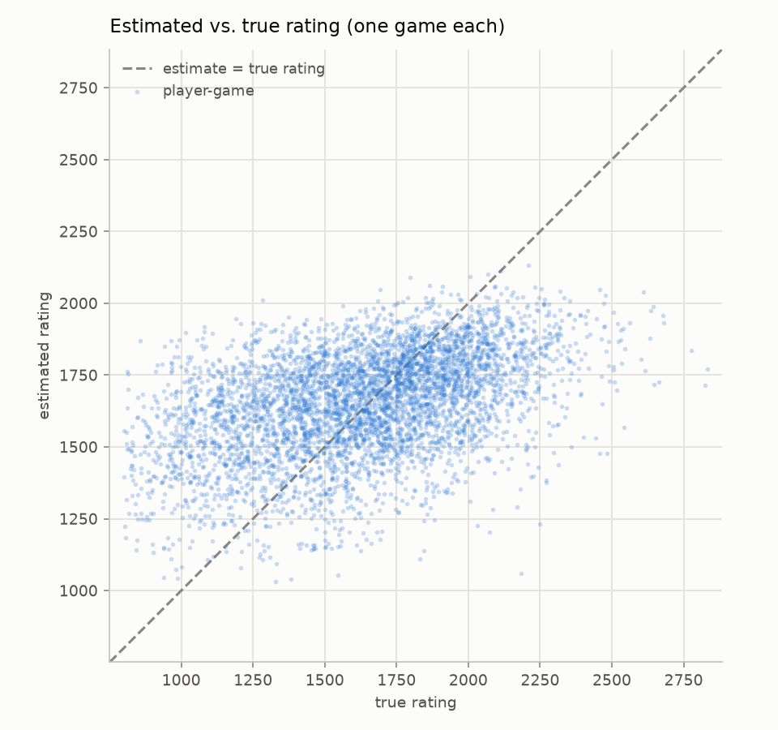
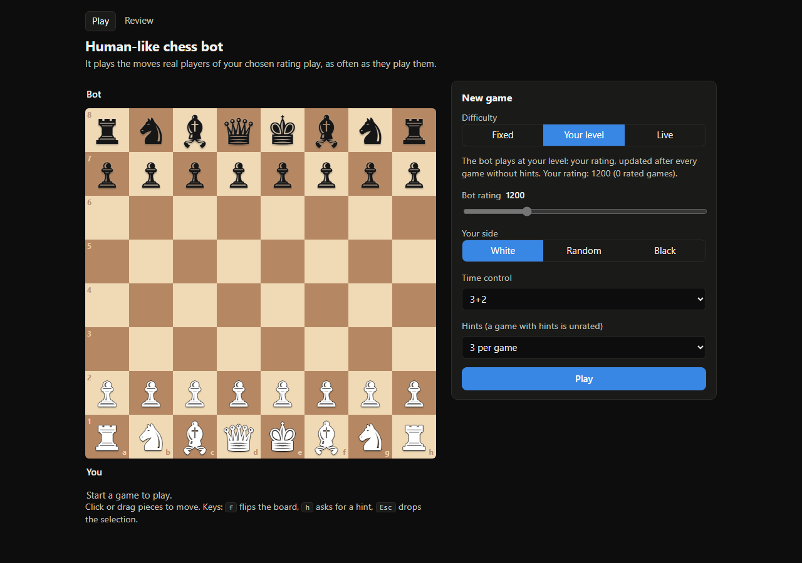

# Progress

See [PLAN.md](PLAN.md) for details on each step.

## Checklist

- [x] 1. Project setup
- [x] 2. Data download + streaming parser
- [x] 3. Board + move encoding
- [x] 4. Dataset builder
- [x] 5. Model
- [x] 6. Training pipeline
- [x] 7. Evaluation + baselines
- [x] 8. Bot move selection + CLI
- [x] 9. Backend API
- [x] 10. Web UI for playing
- [x] 11. Elo dial validation
- [x] 12. Rating estimation
- [x] 13. Game import
- [x] 14. Game review engine
- [x] 15. "Your level vs. next level" + mistake coach
- [x] 16. Review UI
- [x] 17. Tiered hints
- [x] 18. Adaptive difficulty
- [ ] 19. Style imitation + ghost mode
- [ ] 20. Polish

## Step 1: Project setup (done 2026-11-20)

**Built**
- `src/` layout package `chess_engine` with subpackages `data`, `encoding`, `model`, `training`,
  `eval`, `bot`, `review`, `api`. Placeholder modules (docstring only) name the step that fills them in.
- `pyproject.toml` is the single dependency list (installed with `pip install -e ".[dev]"`).
- Config system (`chess_engine.config`): YAML → validated, immutable pydantic models.
- Stockfish utility (`chess_engine.stockfish`): find → verify → clear error with OS-specific install steps.
- `scripts/check_setup.py`: one command that reports Python, packages, config and Stockfish status.
- Tests: imports of every module, config loading and validation, python-chess behaviour, Stockfish
  detection (using a fake UCI engine) and real-Stockfish tests that skip with instructions if it is missing.

**Decisions**
- **pyproject.toml rather than requirements.txt.** One source of truth, and the editable install makes
  `import chess_engine` work from scripts, tests and notebooks without `sys.path` hacks.
  Major versions are pinned to what was installed and tested (`>=tested,<next major`).
- **pandas 3.1.1 excluded.** On this Windows machine, Smart App Control blocked a DLL inside the
  pandas 3.1.1 wheel. 3.1.0 works. Remove the `!=3.1.1` once a newer release installs cleanly.
- **Config = default.yaml + override file.** `default.yaml` holds every setting (laptop-friendly:
  sample mode ON, small model). Other files (e.g. `full.yaml` for Colab/GPU) list only what changes
  and are deep-merged on top. Unknown keys are errors, so typos fail loudly.
- **pydantic for config validation** (rather than bare dataclasses): type checking, range checks and
  readable errors for free, and FastAPI (step 9) uses it anyway.
- **Relative paths resolve against the project root**, not the current directory, so scripts behave
  the same wherever they are launched from.
- **Rating buckets** are lower edges `[800, 1000, ..., 2200]`, giving 8 buckets:
  800–999, …, 2000–2199, 2200+. Games with a player under 800 are filtered out (`min_rating: 800`).
- **Time control** is filtered by Lichess speed category (`speeds: [blitz]`). Lichess defines the
  speed from base + 40 × increment: blitz is 180–479 s. The parser itself is step 2.
- **Excluded terminations**: `Abandoned`, `Rules infraction`, `Unterminated`.
- **Stockfish lookup order**: `STOCKFISH_PATH` env var → `stockfish.path` in config → `PATH` →
  common install locations. A wrong *explicit* path is an error rather than a silent fallback.
  The env var is the recommended way to set a machine-specific path, so committed configs stay portable.
- **Stockfish checks are tested with a fake UCI engine** (`tests/fixtures/fake_uci_engine.py`), so
  the verify logic is covered even on machines without Stockfish.
- Default Lichess month `2024-01` was a placeholder; step 2 chose `2026-10`.

## Step 2: Data download + streaming parser (done 2026-11-23)

**Built**
- `chess_engine.data.pgn_stream`: lazy PGN splitter (`iter_raw_games`), movetext tokenizer
  (`parse_movetext` → SAN moves, per-move `[%clk]` seconds, result), `TimeControl`/speed
  classification, `GameFilter` (built from config), `GameRecord`, `filter_games` and `FilterStats`.
- `chess_engine.data.sources`: open local `.pgn`/`.pgn.zst` or an HTTP(S) URL as a text stream
  decompressed on the fly; `HTTPRangeReader` resumes dropped connections with `Range` requests;
  `download_file` / `download_lichess_month` for full, resumable, SHA-256-verified downloads.
- `chess_engine.data.game_store`: `GameWriter` (Parquet, batched row groups, written to `.tmp`
  and renamed only when complete) and `prepare_games` (source → filter → Parquet + `.stats.json`).
- Scripts: `scripts/prepare_games.py`, `scripts/download_lichess.py`.
- Tests: an anonymized fixture of 16 real games from the 2026-10 dump (every speed + BOT games),
  plus a local HTTP test server with Range support and fault injection (dropped connections,
  503s, servers that ignore Range).

**Real sample run** (`python scripts/prepare_games.py`, default config, streamed from Lichess)

| | |
|---|---|
| Games read | 116,102 (first 36 MB of the ~31 GB 2026-10 file) |
| Games kept | 50,000 (43.1%), 3.54M positions, 10.1 MB Parquet |
| Time | 30 s on a laptop (parser alone: ~4,800 games/s) |
| Rejected: speed (not blitz) | 62,928 |
| Rejected: too short (< 20 plies) | 1,635 |
| Rejected: a player under 800 | 992 |
| Rejected: BOT account | 286 |
| Rejected: abandoned / rules infraction | 208 |
| Rejected: not rated | 53 |
| Time controls kept | 3+0 43%, 5+0 26%, 3+2 19%, 5+3 9% |
| Player-games per bucket | 800: 4.1k · 1000: 8.8k · 1200: 13.4k · 1400: 19.2k · 1600: 21.1k · 1800: 18.7k · 2000: 10.6k · 2200+: 4.2k |

Replaying the first 5,000 kept games with python-chess found 0 illegal moves.

**Decisions**
- **Month 2026-10** (latest complete month). Each file is ~30 GB, but sample mode only streams the
  start, so the month choice costs nothing on a laptop. More months can be listed in config.
- **Sample mode streams straight from the Lichess server** instead of downloading: 50k games need
  ~36 MB of a 31 GB file. Full runs use `download_lichess.py` first (resumable, checksum-verified),
  and `prepare_games.py` automatically uses a downloaded file in `data/raw/` when there is one.
- **Fast header-first filtering, no python-chess in step 2.** Headers are checked before the movetext
  is even tokenized, and moves are kept as SAN without replaying them (python-chess replay runs at
  ~550 games/s, ~9× slower than the parser). Step 4 has to replay every game anyway to get positions,
  so legality is checked there, once.
- **Moves stored as SAN lists, clocks as float seconds**, one row per game. SAN is what the file
  contains (no conversion cost) and is human-readable; step 4 converts while replaying.
- **BOT games excluded** (`exclude_titles: [BOT]`): the model should learn human moves only.
- **Clocks required** (`require_clocks: true`) and all-or-nothing per game: either every move has a
  `[%clk]` or the game is dropped, so step 4 can rely on a clock for every position.
- **"Rated" check**: Swiss events are named `Blitz swiss https://...` with no "Rated" prefix, so a game
  counts as rated if the event starts with "Rated" or it has a `RatingDiff` header. (The first real run
  wrongly rejected 589 rated Swiss games; now 53 remain, Swiss games without rating changes.)
- **Ratings**: both players must be ≥ `min_rating` (and ≤ `max_rating` if set); a `?` rating rejects.
- **Robust streaming**: dropped connections and 5xx errors are retried with exponential backoff and
  resumed at the exact byte, invalid UTF-8 is replaced instead of crashing, outputs are written to
  temporary files and renamed only when complete. Only a generic `User-Agent` is sent.
- **Test fixture is real data, anonymized**: player names and game ids replaced; the data is CC0.

## Step 3: Board + move encoding (done 2026-11-23)

**Built**
- `chess_engine.encoding.moves`: a fixed 1858-move vocabulary (`MOVE_VOCABULARY`), `move_to_index`,
  `index_to_move`, `legal_move_indices`, `legal_move_mask`, `masked_moves`.
- `chess_engine.encoding.board`: `encode_board` → `(20, 8, 8)` planes, `encode_boards` (batch),
  `decode_board` (inverse, for debugging and tests), `PLANE_NAMES` / `PLANE_INDEX`.
- `scripts/benchmark_encoding.py`: times each encoder on positions replayed from the step-2 output.
- Tests run on 312 positions: hand-picked edge cases (Kiwipete for both colours, promotions
  and underpromotions for both colours, en passant for both colours, partial castling rights,
  check, checkmate, stalemate, a 218-move position) plus seeded random games.

**Input planes** (all from the side to move's view)

| Planes | Content |
|---|---|
| 0–5 | my pawns, knights, bishops, rooks, queens, king |
| 6–11 | their pawns … king |
| 12 | white to move (all 1s or all 0s) |
| 13–16 | castling rights: my kingside, my queenside, their kingside, their queenside |
| 17 | en passant target square (only if the capture is legal) |
| 18 | fifty-move counter / 100 (capped at 1) |
| 19 | constant 1s |

**Speed** (`python scripts/benchmark_encoding.py --games 500`, 36,530 real positions, one laptop core):
`encode_board` 18 µs, `legal_move_mask` 96 µs (53 µs of it is python-chess generating legal moves),
`move_to_index` 1 µs, replaying a SAN move 26 µs. About 8,700 positions/s, so the 3.54M positions in
the 50k-game sample take ~7 minutes to encode on one core (step 4 can use several processes).

**Decisions**
- **Side-to-move perspective for both board and moves.** When Black is to move, the board is mirrored
  vertically and the colours swap roles, and Black's moves are mirrored the same way, so the network
  only ever learns "my move" and its policy head is shared between colours. Tested by checking that
  `board` and `board.mirror()` give identical piece planes and identical legal-move indices.
- **A white-to-move plane is still included.** Mirroring makes the colours look the same, but humans
  don't play them the same (opening repertoires, White's extra tempo), so the model can use it.
- **1858-move flat policy** (from→to pairs reachable by a queen or knight move, plus 66 underpromotions),
  the same size as Leela Chess Zero's, rather than AlphaZero's 8×8×73 = 4672 (most of which can never be
  legal). Queen promotion shares the plain from→to index: in any position only one piece can stand on
  the from-square, so there is no ambiguity, and `index_to_move` re-adds the queen promotion when a pawn
  reaches the last rank.
- **Castling = king moves two squares** (`e1g1`), python-chess's standard-chess convention. Chess960
  boards raise an error instead of being silently mis-encoded.
- **En passant only when the capture is legal.** python-chess sets `ep_square` after every double pawn
  push; encoding it only when a capture is possible makes identical positions encode identically.
- **No move history planes for now.** The position itself is enough to start with; history can be added
  as extra planes later without changing the move encoding.
- **Bitboards → planes with `numpy.unpackbits`** instead of looping over squares in Python.
- **`legal_move_mask` vectorized** with numpy lookup tables (121 → 96 µs per position); the rest is
  python-chess's move generator.
- **`encode_board` returns float32 by default**; `fifty_move_clock` is the only fractional plane, so the
  other 19 planes can be stored as bits/uint8 in step 4.

## Step 4: Dataset builder (done 2026-11-23)

**Built**
- `chess_engine.data.splits`: train/val/test assignment from a seeded hash of the game id.
- `chess_engine.encoding.compact`: a 99-byte stored form of a position (12 bitboards + flags + en passant
  + halfmove clock) and `planes_from_compact`, which rebuilds a whole batch of `encode_board` planes with numpy.
- `chess_engine.data.samples`: replays a game into one sample per position (`Samples`, a columnar container
  with ragged legal-move lists, `take`, `concat` and `legal_mask`).
- `chess_engine.data.shards`: `.npz` shard files (versioned, written to `.tmp` then renamed) and
  `ShardWriter`, which shuffles each shard with a fixed seed.
- `chess_engine.data.dataset_builder`: `build_dataset` (games Parquet → shards per split + `games.parquet`
  index + `manifest.json`), parallel across worker processes; the whole directory is built under `.tmp`
  and renamed when complete.
- `chess_engine.data.dataset`: `PositionDataset` reads a split and yields `Batch`es (planes, legal mask,
  target move, features), either fully in memory or one shard at a time.
- Scripts: `scripts/build_dataset.py`, `scripts/inspect_dataset.py` (decodes random samples back into
  boards and moves as a sanity check).

**One sample per position**

| Column | Content |
|---|---|
| `pieces`, `flags`, `ep`, `halfmove` | the board, compact form (decodes to exactly `encode_board`'s 20 planes) |
| `move` | policy index of the move the human played (the target) |
| `legal_count` + shared `legal_moves` | the position's legal moves (rebuilt into the 1858-entry mask per batch) |
| `rating`, `bucket`, `opp_rating` | the mover's rating and bucket, the opponent's rating |
| `clock`, `opp_clock`, `time_spent` | both players' time left before the move, and seconds spent on it |
| `base_seconds`, `increment`, `ply`, `result` | time control, move number, game result for the mover (+1/0/-1) |
| `game` | row in the dataset's `games.parquet` (game id, split, ratings, positions kept) |

**Real build** (`python scripts/build_dataset.py`, the 50k-game sample from step 2)

| Split | Games | Positions | Shards |
|---|---|---|---|
| train | 45,086 | 3,191,533 | 16 |
| val | 2,470 | 176,658 | 1 |
| test | 2,444 | 172,086 | 1 |

- All 50,000 games replayed with **0 illegal moves**, giving 3,540,277 positions, which matches step 2's count.
- **164 MB on disk** (46 bytes/position with zlib) and 189 bytes/position in memory, so the whole training
  split fits in ~0.6 GB of RAM.
- **Took 220 s** with 7 workers on an otherwise idle laptop (~16,000 positions/s). The first build, run while
  other programs kept the CPU ~95% busy, took 703 s with identical output.
- **Worker scaling is limited by the laptop's CPU**: on 5,000 games, 1 worker took 32 s, 4 took 21 s
  and 7 took 22 s. Encoding alone shows why: 37 s of CPU work on 1 worker becomes 70 s in total on 4, so each
  core runs about half as fast once several are busy. The Core Ultra 9 288V is power-limited and has only
  4 performance cores. A desktop or cloud machine with more cores should scale further.
- Loading: the whole training split (3.19M positions) loads in 2.2 s. Batches of 256 decode at
  ~130,000 positions/s (2 ms per batch), far faster than a network will train on a laptop.
- Encoding benchmark on the idle laptop (`benchmark_encoding.py --games 500`): `encode_board` 13.5 µs,
  `legal_move_mask` 42 µs, replay 27 µs per position (~18,000 positions/s per core, 2× the step-3 figures,
  which were also measured on a busy machine).
- 2,000 random test samples were checked against a fresh replay of their games: the planes, legal mask,
  target move and rating all match. The decoded boards look right in `inspect_dataset.py`.
- Positions per bucket (train): 800: 113k · 1000: 253k · 1200: 406k · 1400: 599k · 1600: 678k · 1800: 625k
  · 2000: 366k · 2200+: 152k. The lowest bucket has 6× fewer positions than the biggest. Step 6 should
  weight or resample by bucket so low ratings are not under-learned.
- Average 29.6 legal moves per position; median 2 s spent per move; 9% of positions have under 30 s on the clock.

**Decisions**
- **Split by game with a hash of `(seed, game_id)`**, not a shuffled list: every position of a game is in
  one split, re-running gives the same split, adding games never moves existing ones, and later steps
  (rating estimation on held-out games) can find the test games from their ids alone.
- **Compact boards instead of stored planes**: 99 bytes instead of 5 KB per position. Decoding is a few numpy
  operations per batch and is tested to match `encode_board` exactly on every test position.
- **Legal moves stored as lists, not masks**: ~30 int16s instead of 1858 bits per position, about 3× smaller
  and well compressed; masks are rebuilt per batch.
- **Shuffled within shards when written, then globally when training**: positions of one game are spread
  across a 200k-position shard (~2,800 games), so even shard-by-shard streaming gives well-mixed batches.
- **Clocks before the move** for both players, plus time spent on it. Lichess doesn't run the clock or add
  the increment on each side's first move, so the first two moves count as 0 s spent.
- **Every position is kept by default** (`skip_first_plies: 0`, `min_clock_seconds: 0`). The bot has to
  play openings and time scrambles like a human too; both filters are in the config for experiments.
- **The mover's rating and the opponent's rating are both stored**, plus the bucket. Buckets are also
  recomputable from the rating if the edges change.
- **Parallel encoding with ordered results**: worker processes encode batches of 500 games, results are
  collected in order with a bounded queue, so output is byte-identical for any worker count (tested)
  and memory does not grow with the number of games.
- **Shards are compressed and written on background threads** (zlib releases the GIL), so the main process
  keeps collecting worker results. Compression is ~9 s per 5,000 games on one core. On this laptop it was
  already hidden behind encoding, but it would become the bottleneck on a machine with many cores.
- **NumPy `.npz` shards** (compressed by default; `--no-compress` for faster loading) rather than
  Parquet. Samples are fixed-size numeric arrays that the training loop wants as numpy, and there is
  no per-row overhead.
- **Each dataset records its encoding** (plane names, number of moves, format version) in its manifest, and
  `PositionDataset` refuses to load a dataset built with a different encoding.

## Step 5: Model (done 2026-11-23)

**Built** (`chess_engine.model`)
- `features`: dataset batch → `ModelInputs` (board planes, mover's bucket, opponent's bucket, 5 clock
  features) and `Targets` (played move, legal mask, result as loss/draw/win).
- `layers`: `ConditionEncoder` (rating embedding + opponent embedding + clock features → MLP → one vector
  per position) and `ConditionedResidualBlock` (residual block modulated by that vector).
- `policy_map`: the 1858 vocabulary moves laid out as 73 move types × 64 from-squares (AlphaZero-style),
  so the policy head can be convolutional.
- `heads`: convolutional policy head (default), dense policy head (alternative), win/draw/loss value head.
- `network`: `RatingConditionedNet`, `build_model(cfg)`, `count_parameters`.
- `masking`: illegal moves masked out: `masked_logits`, `legal_probs` (with temperature),
  `legal_log_probs`, `policy_loss` (cross-entropy over legal moves only).
- `inference`: `MovePredictor` (`chess.Board` + rating → every legal move with its probability, plus
  win/draw/loss), `save_model` / `load_model` (weights + config + bucket edges + encoding in one file).
- `scripts/model_summary.py`: parameters per part, CPU speed, estimated epoch time.

**Architecture** (default config)

```
board planes (20x8x8) -> 3x3 conv stem (64) -> 6 residual blocks (64 channels) -> policy head -> 1858 logits
                                                  ^ FiLM in every block          -> value head  -> W/D/L
mover's bucket, opponent's bucket, clocks -> ConditionEncoder -> conditioning vector (64)
```

| Part | Parameters |
|---|---|
| condition encoder | 11,072 |
| stem | 11,648 |
| 6 residual blocks | 493,824 |
| policy head (conv) | 41,737 |
| value head | 74,771 |
| **total** | **633,052** |

**Checks**
- The convolutional head's gather is tested move by move against the raw 73-plane output, and every
  vocabulary move maps to a distinct (move type, square).
- **The network learns what it is for** (tiny models, a few seconds of training each, in `tests/test_model_learning.py`):
  - it memorizes a batch of real positions (over 90% top-1);
  - from the *same* position it learns a different move for each rating bucket, with both `add` and `film`;
  - it learns moves that depend on the opponent's rating combined with the clock;
  - with opponent/clock conditioning turned off it cannot tell those cases apart;
  - the value head learns that the higher-rated player wins.
- Untrained, the rating has no effect on the policy, by design (see decisions); every parameter receives
  gradients.
- `MovePredictor` covers every legal move, including castling, promotions and Black to move, sums to 1,
  gives the same results batched as one by one, and survives a save/load round trip.

**Speed** (`python scripts/model_summary.py --threads 4`, laptop CPU, batch 256): forward pass ~1,450
positions/s, training step ~380 positions/s, so **one epoch over the 3.19M training positions would take
~2.3 h on this laptop**. This is compute-bound (~180 MFLOP per position per training step), not overhead.
For comparison: 48 channels × 4 blocks trains at ~780 positions/s and 32 × 4 at ~1,250.
- 4 torch threads is the fastest setting here (8 is no faster: 4 performance cores).
- Channels-last memory layout gives only ~8%, and bfloat16 training is not supported by this CPU's oneDNN
  build.
- **Implication for step 6:** on the laptop, train on part of an epoch or use a smaller config for quick
  runs; the full sample (and anything bigger) belongs on a GPU (Colab), as PLAN.md anticipated.

**Decisions**
- **FiLM conditioning in every residual block** (default; `add` is available). The rating has to change
  *which* features matter, not just shift them, and putting it in every block lets it act at every depth.
  The modulation layers start at zero, so training starts from a plain ResNet and learns how much the
  rating matters; this keeps early training stable.
- **The opponent's rating and both clocks are inputs too** (both can be turned off in the config). Humans
  play differently against stronger opponents and in time trouble, and the bot needs to imitate that. At
  play time they are set from the actual game (default: equal ratings, full clocks).
- **Clock features are normalized two ways**: a fraction of the starting time *and* log-seconds, so the
  model sees both "used half my time" and "10 seconds left", which mean different things in 3+0 and 5+3.
- **Separate learned embedding per bucket** (8 × 32 numbers): simple, and the training data in every bucket
  is plentiful. Neighbouring buckets are not forced to be similar; that can be revisited if low-data
  buckets look noisy.
- **Convolutional policy head** (73 move types per square, gathered to the 1858 moves): 42k parameters instead
  of 3.8M for a dense head, weights shared across squares, and the spatial structure is kept. The dense
  head is still available (`policy_head: fc`) for comparison in step 7.
- **Value head included** (win/draw/loss for the mover, reading the conditioning too). It is an
  auxiliary training target that helps the trunk learn what matters in a position, and it will be useful for
  game review. Step 6 sets its loss weight.
- **The network outputs unmasked logits**; masking is a separate function, applied identically in the loss,
  in sampling and in inference. Illegal moves get the smallest finite value (not `-inf`), so nothing turns
  into NaN, also in float16.
- **Model files are self-describing and safe**: weights + config + bucket edges + encoding info, loaded with
  `weights_only=True` (an untrusted file cannot run code), and rejected if the encoding differs.

## Step 6: Training pipeline (done 2026-11-24)

**Built** (`chess_engine.training`)
- `device`: device choice (CUDA > MPS > CPU), seeding of every random generator, CPU threads, mixed precision
  (bf16 or fp16 on GPUs, fp32 on CPU).
- `schedule`: linear warmup, then constant / cosine / linear decay to `min_lr_fraction`, as a pure function of the step.
- `balancing`: rating-bucket weights `(n_b / mean)^-power`, normalized so the average weight per position is 1.
- `order`: the epoch's position order from `(seed, epoch)` only: a shuffle, or resampling by bucket.
- `loader`: dataset split -> `TrainBatch` tensors, decoded ahead on a background thread (pinned memory on CUDA).
- `losses`: weighted cross-entropy of the human move over the legal moves (label smoothing over legal moves
  only) + `value_loss_weight` x win/draw/loss cross-entropy.
- `metrics` / `validation`: running means, top-1/3/5 and value accuracy per rating bucket on fixed validation positions.
- `checkpoint`: model + optimizer + scheduler + grad-scaler + counters, written atomically, loaded with
  `weights_only=True`, newest `keep_checkpoints` kept.
- `run_log`: one directory per run (config snapshot, `run.json`, crash-safe `metrics.jsonl`).
- `train`: `Trainer` (validation every `eval_every_steps` and at each epoch end, `best_model.pt` export,
  checkpoints, resume, stop on `max_steps` / `max_minutes` / Ctrl+C) and `history` (curves from the log).
- `chess_engine.plotting`: the shared chart style for report PNGs.
- Scripts: `scripts/train.py`, `scripts/plot_training.py`. Config: the `training:` section, `configs/laptop.yaml`.
- Tests (about 100 new): every module, plus whole-pipeline checks: training lowers the loss and saves a usable model;
  **a run paused mid-epoch or at an epoch boundary and resumed gives bit-identical weights** to an uninterrupted
  run; and games -> dataset -> `Trainer` -> saved model learns that low-rated players open 1.e4 and high-rated
  ones 1.d4 from the identical start position, with both balancing modes.

**Reference run** (`python scripts/train.py --config configs/laptop.yaml --run-name laptop_64x6`, the default
64x6 model, 633k parameters, on the laptop CPU with 4 threads)

| | |
|---|---|
| Training | 10,000 steps x 256 = 2.56M positions (80% of one epoch of the 50k-game sample) |
| Schedule | AdamW, peak learning rate 1e-3 after 500 warmup steps, cosine decay to 5e-5 |
| Balancing | loss weights, power 0.5 (800-999 positions weigh 1.95, 1600-1799 positions 0.80) |
| Speed | 290-500 positions/s, about 2 hours of computing time |
| Sessions | 3: stopped by the time limit at step 1,969, by the session ending at step ~3,100 (resumed from step 3,000) |
| Validation (20k positions) | **top-1 41.4%, top-3 68.6%, top-5 79.6%**, move log-loss 1.931, result guessed 60.1% |
| Best model | the last step: validation loss improved at every check from step 2,000 on |


| Validation, step 10,000 | 800-999 | 1000-1199 | 1200-1399 | 1400-1599 | 1600-1799 | 1800-1999 | 2000-2199 | 2200+ |
|---|---|---|---|---|---|---|---|---|
| top-1 | 39.8% | 40.6% | 42.0% | 41.6% | 42.2% | 41.8% | 40.1% | 37.8% |
| top-5 | 78.2% | 78.6% | 79.7% | 79.3% | 80.7% | 79.8% | 79.4% | 77.0% |

- **No overfitting, and not converged:** training and validation loss lie on top of each other, and validation
  loss was still falling at the end (2.15 -> 2.13 over the last 2,000 steps, at a tiny learning rate). Less than
  one epoch of 50k games is the limit here, not the model: more data and steps (the GPU config) should keep improving it.
- **The rarest buckets are the hardest:** 2200+ (4.8% of the data) is lowest at 37.8% and 800-999 (3.5%) next.
  Balancing gives them 1.7-2x weight per position, but they still see far fewer positions. The step-7 evaluation
  looks at this on the test set with confidence intervals.
- Validation top-1 rose 32.1% (step 1,000) -> 35.0% (2,000) -> 38.2% (4,000) -> 40.0% (7,000) -> 41.4% (10,000).

**Decisions**
- **The data order is a function of `(seed, epoch)`**, so a checkpoint only needs the step counter to rebuild
  the exact batches still to come; there is no data-loader state to save. Together with checkpointing the
  optimizer, scheduler, grad scaler and RNG, a resumed run is bit-identical to an uninterrupted one (tested).
  This mattered in practice: the reference run was resumed twice.
- **A background decoding thread instead of DataLoader worker processes.** A batch decodes in ~2 ms, while a
  training step takes ~700 ms on this CPU, so one thread is plenty. Worker processes would each need a copy of the
  0.6 GB in-memory split, and starting processes is slow on Windows.
- **Bucket balancing by loss weights, power 0.5** (default). Power 1 would weigh an 800-999 position 3.5x;
  0.5 is a middle ground between "as in the data" and "every bucket equal", and normalizing the weights to an
  average of 1 keeps the loss scale and learning rate unchanged. Resampling (`sample`) is available; it changes
  which positions are seen rather than how much each counts.
- **No weight decay on embeddings, biases or batch-norm parameters.** Decaying a rating embedding would pull a
  rarely seen bucket towards "no rating" between its updates.
- **The best model is chosen by validation loss, not top-1.** The bot samples from the probabilities (step 8), so
  how well the whole distribution fits matters more than the favourite move alone.
- **Validation uses the first 20,000 validation positions**, always the same ones, so every check in every
  run is comparable; a pass takes ~15 s.
- **`max_minutes` counts wall-clock time of the session.** The first session lost three hours while the laptop
  slept and stopped at step 1,969 instead of 10,000. The resulting checkpoint made that harmless.
- **The first Ctrl+C stops at the end of the current step** (checkpoint + final model); the second aborts. A
  plain KeyboardInterrupt could land between the optimizer step and the step counter and save an inconsistent state.
- **Mixed precision only on GPUs** (`auto`): bf16 training is not supported by this CPU's oneDNN build, and
  fp16 on CPU is slower than fp32.
- **Tests train real (tiny) models on real (tiny) datasets**, with 2 torch threads and no worker processes, so
  the ~100 training tests take about 2 minutes.

## Step 7: Evaluation + baselines (done 2026-11-24)

**Built** (`chess_engine.eval`)
- `positions`: a 64-bit key per position (pieces, side to move, castling, legal en passant; move counters
  ignored) and boards rebuilt from stored samples.
- `predictions`: one pass of a model over a split -> a per-position `PredictionTable` (rank and probability of
  the human move, top-5 moves, entropy, win/draw/loss), saved as `.npz`; also accumulates a reliability
  histogram over every legal move. It can tell the model any rating instead of the real one.
- `move_matching`: top-1/3/5, log-likelihood and perplexity per rating bucket; breakdowns by game phase, the
  mover's clock and the number of legal moves.
- `bootstrap`: confidence intervals that resample whole games (also for paired differences).
- `baselines`: most common move in that position in the training games (overall, or at the same rating), with a
  random legal move where the position is new; random legal move (exact `1/legal moves`).
- `stockfish_baseline`: Stockfish's best move on a seeded sample of test positions, cached by depth + FEN.
- `cross_rating`: accuracy of the model told rating *m* on players of real rating *p*, and the best single rating
  for everyone (fixed-rating baseline).
- `calibration`: reliability tables and expected calibration error for every legal move, for the top move, and
  for the value head's expected score.
- `plots`, `report`, `evaluate` (the whole pipeline), `compare` (models on the same positions, paired intervals).
- Scripts: `scripts/evaluate.py`, `scripts/compare_models.py`. Config: the `evaluation:` section.
- Stockfish 19 installed (`winget install --id Stockfish.Stockfish`); the step-1 detection found it with no setup.
- Tests (about 60 new): every module against hand-computed values and direct recomputation, a fake UCI engine
  that plays the first legal move, a real-Stockfish mate-in-one, and the full pipeline end to end.

**Results** (`python scripts/evaluate.py laptop_64x6`: the step-6 model on the 172,086 positions of the 2,444
test games, 8.7 minutes; full report: [reports/eval/laptop_64x6_best_model/report.md](reports/eval/laptop_64x6_best_model/report.md))


| Predictor | Top-1 (all test positions) |
|---|---|
| **model** | **41.7%** (95% CI 41.4-42.0); top-3 68.6%, top-5 79.6%, perplexity 6.8 of 29.7 legal moves |
| model told one rating for everyone (best: 1600-1799) | 42.0% (on 40,000 positions, where the model told the real rating also scores 42.0%) |
| Stockfish 19, depth 10 | 37.6% on 10,000 sampled positions (the model: 42.3% on the same ones) |
| most common move in the training games (opening book) | 12.6% (knows 14.4% of positions: 47.6% there vs. the model's 47.9%) |
| random legal move | 6.3% |

| Rating | 800-999 | 1000-1199 | 1200-1399 | 1400-1599 | 1600-1799 | 1800-1999 | 2000-2199 | 2200+ |
|---|---|---|---|---|---|---|---|---|
| model | 41.2% | 41.9% | 41.9% | 41.6% | 42.2% | 41.9% | 40.9% | 40.2% |
| model, Stockfish's sample | 41.3% | 42.6% | 42.9% | 42.1% | 42.4% | 43.0% | 41.9% | 39.3% |
| Stockfish (356-2,093 positions) | 32.6% | 32.1% | 36.0% | 36.7% | 38.6% | 38.6% | 41.6% | 42.2% |

- **The model predicts human moves better than Stockfish, by the most where players are weakest:** 9-10 points
  at 800-1199, even at 2000-2199, and Stockfish ahead at 2200+ (42.2% vs. 39.3% on 517 positions, about +-4 points
  of noise). Stockfish's match rate climbs steadily with rating, as expected: strong players play the engine
  move more often. This is the gap a human-like model exists to fill.
- **Rating conditioning barely works yet.** Telling the model each player's real rating is no better than one
  rating for everyone (42.0% vs. 42.0%). The cross-rating matrix is nearly flat: the only clear effect is for
  2200+ players, predicted at 41.7% when the model is told "2200+" and 38.3% when told "800-999"; for players
  under 1800 the rating the model is told moves accuracy by under 1 point. The rating is used (2200+ shows it),
  but weakly. Likely causes: training stopped at 80% of one epoch of 50k games (validation loss was still
  falling), the FiLM layers start at zero so the rating has to earn its influence, and imitating *this* rating
  rather than "a typical human" is a small extra signal that needs much more data per bucket. This is the main
  thing to fix before the Elo dial (step 11) can work: train longer on more games (GPU), and check the matrix again.
- **Probabilities are well calibrated** (expected calibration error 0.0007 over all 5.1M legal-move predictions,
  0.010 for the top move), which matters because the bot will sample from them.
- **The model has learned the openings:** on the 14% of test positions that also occur in training games it matches
  the human move as often as the book of those games does (47.9% vs. 47.6%). Accuracy is highest in the opening
  (45.6% for moves 1-10), lowest in the middlegame (38.8% for moves 26-40), and drops as the number of legal
  moves grows (63% with up to 10, 35% with over 40). Time pressure changes little (41.0% under 15 s vs. 42.3% over 2 min).
- The value head guesses the game result from a position 61.3% of the time (draws are 5% of results) with a
  well calibrated expected score (calibration error 0.008).

**Decisions**
- **Held-out test split only.** Model selection used the validation split, so the test games were never looked at
  before this evaluation.
- **Confidence intervals resample whole games**, not positions: positions of one game share a player and an
  opening, so treating them as independent would make intervals too narrow (a test shows game-correlated data gets
  a 4x wider interval). Model-vs-baseline differences use paired intervals on the same positions.
- **The most-common-move baseline falls back to a random legal move** for positions not in the training games, and
  its coverage is reported, because an opening book is only meaningful where it has an entry.
- **Stockfish at depth 10 on a 10,000-position seeded sample** (3.5 minutes): depth 10 is far stronger than any
  human here, and the first run with 2,000 positions gave only 90-415 positions per rating, too few for a per-rating
  trend. Answers are cached by depth + FEN in `data/cache/`, so other models reuse them.
- **The fixed-rating baseline is the same network** told one rating for everyone, so the comparison isolates what
  rating conditioning adds; the cross-rating matrix shows the same thing per rating group.
- **Calibration over every legal move** is accumulated during the prediction pass as a histogram: 5.1M
  move probabilities would be too many to store.
- **Reports are committed** (`reports/eval/<run>_<model>/`: `report.md`, `results.json`, four charts) with paths
  relative to the project; the 10 MB `predictions.npz` next to them is git-ignored and can be regenerated.
- **Charts use one fixed colour per predictor** (the model is always blue) and a light-to-dark ramp for rating
  buckets, from `chess_engine.plotting`.

## Step 8: Bot move selection + CLI (done 2026-11-24)

**Built** (`chess_engine.bot`)
- `sampling`: the bot's probabilities from the model's: filters (`top_k`, `top_p`, `min_prob`, never removing the
  likeliest move), then `temperature` (`p^(1/T)`; 0 = always the likeliest move).
- `player`: `BotPlayer.choose_move(board, opp_rating, clocks, time control)` returns the move, the model's probability
  for it, the chance the bot had of choosing it, every candidate and the win/draw/loss estimate; `load_bot` builds
  one from the config (`bot:` section) or a model file; ratings 400-3000 are accepted.
- `game`: `Game` with SAN/UCI input (a bare `e7e8` promotes to a queen), checkmate / stalemate / insufficient
  material, threefold repetition and fifty-move draws applied automatically, resignation, time forfeit (a draw if the
  opponent cannot mate), takebacks, move list and PGN.
- `clock`: `ChessClock` / `TimeControl` (`3+2`), clocks start after both first moves and add the increment, as on
  Lichess; the time source is injectable for tests.
- `cli`: `TerminalGame`, the terminal game loop (board with the last move marked, Unicode pieces when the terminal
  can show them, `help` / `undo` / `flip` / `moves` / `resign` / `quit`, clocks, optional bot "thinking").
- `selfplay`: bot-vs-bot games and match scores with intervals and an Elo estimate.
- Scripts: `scripts/play.py` (play the bot), `scripts/bot_match.py` (bots of different ratings play each other).
- Tests (41 new + 4 script tests): sampled moves follow the adjusted probabilities, seeded bots repeat, the rating
  and clocks reach the model, every game ending, clock arithmetic with a fake time source, whole scripted terminal
  games (including a time forfeit), and the scripts with a small model file.

**Playing it** (`python scripts/play.py --rating 1200 --show-thinking`, the step-6 model): the bot opens like a
club player (1. e4 e5 2. Nf3 Nc6, the moves 1200s choose 48% and 69% of the time) and sometimes plays the
less common moves they also play, e.g. 3. Bc4 h6, a move players rated ~1200 choose 6% of the time.

**Bot vs. bot** (`python scripts/bot_match.py --ratings 900 1500 2100 --games 40`, no clocks, colours alternating,
about a minute per 40 games)

| Pairing | Result for the higher-rated bot | Score (95% interval) | Elo difference |
|---|---|---|---|
| 1500 vs. 900 | +8 =23 -9 | 48.8% (39-59%) | -9 |
| 2100 vs. 1500 | +9 =23 -8 | 51.2% (41-61%) | +9 |
| 2100 vs. 900 | +10 =30 -0 | **62.5% (56-69%)** | **+89** |

- **The rating dial works only at the extremes so far**, exactly as the step-7 cross-rating matrix predicted: the 2100
  bot never lost to the 900 bot, but 600-point gaps in the middle make no measurable difference. The model needs
  more training before the dial is useful (step 11 measures it properly, also against Stockfish levels).
- **Most games end in draws by stalemate or bare kings** (10 stalemates and 11-18 insufficient-material draws per
  40 games). The bots imitate human moves but never resign, and human blitz games that reach a won endgame usually
  end by resignation or on time, so the model has seen few endgames played out to mate. A resignation rule (e.g.
  from the value head) would make bot games more human; it belongs with the adaptive features later.

**Decisions**
- **Default: play moves exactly as often as humans of that rating do** (`temperature: 1`). That is what makes the bot
  human-like, mistakes included; `temperature < 1` makes it play its rating's *typical* move more often, and 0 makes
  it deterministic (strongest, least human). Step 11 will measure how temperature moves its strength.
- **Filters before temperature, and the likeliest move always survives**, so no combination of settings can leave the
  bot without a move, and `min_prob` refers to the model's own probabilities, not to sharpened ones.
- **The bot is told the opponent's rating and both clocks**, so a bot in time trouble plays like a human in time
  trouble. In untimed games both sides are told they have the full base time (3+0 by default).
- **Draws by repetition and the fifty-move rule end the game when they happen**, as on Lichess, not one move early
  as python-chess's `claim_draw` would; a game against the bot cannot go on forever.
- **Game and clock logic live in the library, not the script**, so the API (step 9) and the web UI (step 10) reuse
  `Game`, `ChessClock` and `BotPlayer` unchanged.
- **The bot is charged its real thinking time** on the clock (a few milliseconds per move); simulating human
  thinking time is not part of the model yet.

## Step 9: Backend API (done 2026-11-24)

**Built** (`chess_engine.api`)
- `schemas`: request and response bodies (pydantic) with validation: rating 400-3000, colour, time control (`3+2`),
  sampling overrides, a legal starting FEN; responses give moves in both UCI (for a board widget) and SAN.
- `store`: in-memory games under random 16-character ids; games idle for `idle_minutes` are dropped, and at
  `max_games` the least recently used one makes room; thread-safe.
- `service`: `GameService`, the game logic without HTTP: create (the bot opens if it has White), play a move (with
  the bot's reply in the same call by default), bot move, resign, takeback, PGN, and server-side clocks (flag fall
  checked on every request, both clocks passed to the bot).
- `app`: `create_app`, the FastAPI app; the model is loaded once at startup.
- Script: `scripts/serve.py` (uvicorn). Config: the `api:` section. Dev dependency: `httpx` (FastAPI's test client).
- Tests (about 40 new): validation, the store's expiry and cap with a fake time source, the service, and every
  endpoint over HTTP with a small in-memory model, including a game to checkmate, a time forfeit, takebacks,
  CORS and the error format.

**Endpoints** (all under `/api`, JSON; interactive docs at `/docs`)

| Method | Path | What it does |
|---|---|---|
| GET | `/api/health` | status, model file, games in memory |
| POST | `/api/games` | start a game: `rating`, `color` (white/black/random), `your_rating`, `time_control`, `temperature`, `top_k`, `top_p`, `seed`, `fen` |
| GET | `/api/games/{id}` | the state: FEN, turn, moves (SAN + UCI), legal moves, clocks, outcome, the bot's last move with its candidates |
| GET | `/api/games/{id}/legal-moves` | the side to move's legal moves |
| POST | `/api/games/{id}/moves` | `{"move": "e4"}`; the bot replies in the same response unless `"reply": false` |
| POST | `/api/games/{id}/bot-move` | the bot plays (after a move sent with `"reply": false`) |
| POST | `/api/games/{id}/resign` | you resign |
| POST | `/api/games/{id}/takeback` | undo your last move and the bot's reply (untimed games) |
| GET | `/api/games/{id}/pgn` | the game as PGN |

Errors always look like `{"error": "<code>", "detail": "<message>"}`: 404 `game_not_found`; 409 `game_over`,
`not_your_turn`, `not_bots_turn`, `nothing_to_take_back`, `timed_game`; 422 `illegal_move`, `invalid_request`.

**Smoke test** (`python scripts/serve.py`, the step-6 model, a 5+0 game at rating 1200 over curl): the server
starts in a few seconds, each move round trip with the bot's reply takes well under a second on the laptop CPU,
the clocks run (the bot spends ~0.05 s per move), and the bot's candidates come back with every reply
(after 1. e4: e5 48%, c5 11%, d5 11%).

**Decisions**
- **One model for the whole server, one `BotPlayer` per game.** Loading the model takes a few seconds and ~10 MB of
  memory; each game only needs its own rating, sampling settings and random generator.
- **The bot replies in the same request by default** (`reply: true`), so a client needs one round trip per move;
  `reply: false` + `/bot-move` lets a UI show your move first and then ask for the bot's.
- **Game logic in a service class, not in the route functions**, so it is tested without HTTP and the routes stay
  one line each. The terminal game (step 8) and the API share `Game`, `ChessClock` and `BotPlayer`.
- **Clocks live on the server** and a flag fall is checked on every request, so a client cannot cheat or forget
  the time; timed games do not allow takebacks (the clocks would need rewinding).
- **Games are in memory only.** This is a local, single-user server; finished games are kept by saving their PGN.
  Ids are random (`secrets.token_urlsafe`) so one game cannot be guessed from another.
- **Local by default** (`127.0.0.1`) with CORS limited to the local origins the web UI (step 10) will use.
- **`httpx` for the test client.** Starlette 1.10 prints a deprecation warning suggesting a package named `httpx2`
  instead; that package was not installed (it is new and was not vetted), so API tests show one harmless warning.

## Step 10: Web UI for playing (done 2026-11-24)

**Built** (`web/`, served by the step-9 app at `/`)
- `index.html` + `css/style.css`: the play page: board with both players' names and clocks, a new-game form (bot
  rating 800-2400, side, time control), the move list, Flip / Take back / Resign, and a panel showing what players
  of the bot's rating chose in the position before its last move (with the probability bars). Colour tokens with a
  dark mode; the board keeps classic wood colours in both; it fits a phone (checked at 375 px) and a desktop.
- `js/board.js`: a dependency-free chessboard: renders a FEN in either orientation with coordinates, last-move and
  check highlights; moves by click (piece, then target) or drag (mouse, pen, touch); shows legal targets; asks
  which piece to promote to. It does not know the rules: the legal moves come from the server.
- `js/api.js`: the API calls, with server errors turned into readable messages.
- `js/app.js`: the page logic: start a game (your move shows at once, then the bot's reply), clocks counted down
  locally from the server's time (red under 20 s; at zero the page asks the server, which ends the game), result
  banner with Download / Copy PGN and New game, resign with a confirming second click, takeback (untimed games),
  the game id in the URL (`#game=<id>`) so a reload continues the game, remembered settings, `f` / `Esc` keys.
- `tests/`: the page's own tests, run by pytest in headless Chrome / Edge (`tests/test_web_js.py`, skipped
  without a browser): 12 board unit tests, and 19 end-to-end tests that load the real page against the real
  FastAPI app (small model) on a local port: starting games as White and Black, clicking and dragging moves,
  the bot's replies, clocks, flag checks, resign, takeback, checkmate, resume from the URL, errors.


**Checked by looking at it** (headless-Chrome screenshots of real games on the step-6 model), which found and fixed
three bugs the first tests missed: the promotion overlay's dark backdrop always covered the board (a `display`
rule overrode the `hidden` attribute), the candidate-move bars were empty (inline spans ignore `width`), and the
keyboard handler failed on key events aimed at the page itself. Each now has a regression test. The tests also
caught square colours being swapped (a1 must be dark).

**Decisions**
- **Plain HTML, CSS and JavaScript modules, no build step and no libraries.** The page is about 1,000 lines in total; a
  chessboard library would bring a licence to check, a CDN or vendored files, and code that duplicates what
  the server already knows (legal moves). The board renders Unicode chess symbols, so there are no image files.
- **The server is the single source of truth.** The page never decides legality, results or time: it shows the
  last state from the API and sends what the player does. Clocks tick locally only for display.
- **Your move is shown before the bot answers** (`reply: false`, then `/bot-move`), so the board responds
  instantly even if the bot takes a moment.
- **Served by the API app at `/`**, so page and API share one origin (no CORS needed) and one command
  (`python scripts/serve.py`) runs everything.
- **Testing in a real browser without Node.js:** pytest serves the page and the API and reads the results from
  headless Chrome's DOM; screenshots were used to look at the result (headless Chrome will not go below a 504 px
  viewport, so phone width was checked inside a 375 px iframe).

## Step 11: Elo dial validation (done 2026-11-24)

**Built** (`chess_engine.eval`)
- `players`: one interface for match players: `BotAgent` (the human-like bot) and `StockfishPlayer` (Stockfish 19
  limited with `UCI_LimitStrength` / `UCI_Elo`, one process kept open), plus a `Judge` (full Stockfish at a fixed
  node count) that evaluates positions.
- `arena`: one game between any two players; the judge ends clearly decided games (one side ahead by 800 centipawns
  for 8 plies in a row) and decides games that reach the move limit.
- `elo_validation`: the schedule (every bot setting against every Stockfish level, and bot against bot), a
  resumable JSON-lines game log, and `analyze` (scores per pairing, measured strength per dial setting).
- `elo_fit`: maximum-likelihood Elo ratings anchored to the Stockfish levels, bootstrap intervals (games resampled
  within each pairing), rank correlation, Elo per dial point and the chance each step up is really stronger.
- `elo_report`: the dial-vs-measured chart, the score matrix and the Markdown report.
- Script: `scripts/elo_validation.py` (run or resume, then report; `--analyze-only`). Config: `elo_validation:`.
- Tests (about 30 new): scripted players and judges for every adjudication rule, the fit recovering known ratings
  from simulated games, resuming an interrupted log, and the script end to end with a fake engine.

**Results** (`python scripts/elo_validation.py`, the step-6 model, bots at 800/1100/1400/1700/2000/2300 sampling at
temperature 1; 460 games in 29 minutes; full report:
[reports/elo/laptop_64x6_best_model/report.md](reports/elo/laptop_64x6_best_model/report.md))


| Dial | 800 | 1100 | 1400 | 1700 | 2000 | 2300 |
|---|---|---|---|---|---|---|
| measured (Stockfish scale) | 311 | 319 | 656 | 912 | 833 | 981 |
| 95% interval | -49 to 496 | 13 to 495 | 431 to 793 | 726 to 1043 | 660 to 938 | 821 to 1116 |
| score vs. Stockfish 1320 | 0% | 0% | 0% | 10% | 5% | 10% |
| score vs. the next setting up | 48% | 10% | 18% | 60% | 30% | |

- **Strength does rise with the dial** (rank correlation 0.94; about 49 Elo of measured strength per 100 points on the
  dial), but in steps, not smoothly. 1100 -> 1400 (+337) and 1400 -> 1700 (+256) are clear in every bootstrap
  resample, and 2000 -> 2300 (+148) in 99%. 800 and 1100 play alike (+8), and 2000 measured *below* 1700 (-78; the
  1700 bot won their match 12-8). This matches the step-7 cross-rating finding: the model separates ratings
  mainly at the ends and around the middle of its range.
- **The bots are far weaker than Stockfish's weakest setting.** Even the 2300 bot scored 10% against Stockfish 1320
  (50 ms per move), and every bot lost every game to Stockfish 1900. So the absolute numbers are extrapolated from
  lopsided scores and mean little; the bot-vs-bot games carry the real information. Stockfish's UCI_Elo scale is
  also not the Lichess blitz scale (it was calibrated against engines at longer time controls). Two reasons the
  bots are weak in absolute terms: at temperature 1 they play the occasional rare move humans play (the mistakes
  included), and a 42%-move-match model after 2 hours of CPU training is still far from human-level understanding.
- **85% of games were decided by the judge**: without adjudication most would have dragged on (the bots never
  resign), which step 8 already showed.

**Decisions**
- **Stockfish levels as fixed anchors, plus bot-vs-bot games.** Anchors put every bot on one known scale; neighbouring
  bots playing each other measure the dial directly, which turned out to be the informative part.
- **A judge instead of resignation rules inside the bot.** The bot imitates humans move by move; deciding when a game is
  lost is a measurement concern here, so it lives in the arena, not in `BotPlayer`.
- **Maximum likelihood with a weak prior**, because whitewashes (0/20) would otherwise push ratings to infinity; the
  prior (800 Elo wide) only matters for those players, whose intervals stay wide.
- **Every game is logged as it finishes**, with a recovery from half-written lines, so a 30-minute run survives
  interruptions (the log is committed as the raw evidence next to the report).
- **What this means for the project:** the dial works enough to give clearly different opponents at 1100, 1400,
  1700 and 2300, but not a smooth 100-point resolution. The fix is the same as step 7's: a model trained longer on
  more games (the GPU config), then re-run this check (`python scripts/elo_validation.py`, ~30 minutes).

## Step 12: Rating estimation (done 2026-11-24)

**Built** (`chess_engine.eval`)
- `rating_estimation`: per-move log-likelihood at every rating bucket in one batched model pass; bucket centres
  (900, 1100, ..., 2300) interpolated to a 600-2800 grid; a prior from the training players' rating distribution
  (smoothed, with a 1% uniform floor) or flat; a tempered posterior summarized as mean, median and a central range;
  `estimate_rating` for one or several games of a player (their evidence adds up).
- `player_games`: one player's moves from PGN text (by name or colour), with the positions, the opponent's rating,
  both clocks before each move (from `[%clk]`) and the time control.
- `rating_eval`: per-move likelihoods for every held-out position at every bucket, grouped into player-games (one
  side of one game); estimates and scores (error, bias, range coverage) against two baselines; fitting the
  temper on validation games; convergence with the number of moves.
- `rating_report`: three charts and the Markdown report.
- Scripts: `scripts/estimate_rating.py` (PGN -> estimate with a range), `scripts/evaluate_rating_estimation.py`.
- Tests (about 40 new): the maths against hand-computed cases, the likelihoods against the predictor, PGN reading
  (names, colours, clocks, custom positions, broken games), synthetic players with known ratings (including
  correlated moves, which the temper must correct), and both scripts.

**Results** (`python scripts/evaluate_rating_estimation.py`: the step-6 model on 4,888 player-games from the
2,444 test games, one game per estimate, 35 moves on average; scoring both splits at 8 ratings took 33 minutes,
cached afterwards; full report: [reports/rating/laptop_64x6_best_model/report.md](reports/rating/laptop_64x6_best_model/report.md))



| | Mean error (Elo) |
|---|---|
| **estimate from the moves of one game** | **253** (median 213, bias +23) |
| guess the average rating (1629) | 286 |
| guess the opponent's rating | **61** |

| True rating | 800-999 | 1000-1199 | 1200-1399 | 1400-1599 | 1600-1799 | 1800-1999 | 2000-2199 | 2200+ |
|---|---|---|---|---|---|---|---|---|
| error | 566 | 434 | 293 | 176 | 125 | 190 | 318 | 535 |
| bias | +566 | +434 | +280 | +109 | -32 | -176 | -318 | -535 |
| inside the 80% range | 18% | 50% | 79% | 95% | 98% | 90% | 66% | 12% |

- **The estimate barely moves away from the middle.** It beats "everyone is average" (253 vs. 286 Elo) and points in
  the right direction, but an 800 player is estimated ~570 too high and a 2200+ player ~540 too low. The cause is
  the one steps 7 and 11 found: the model's move probabilities change little with the rating it is given, so a
  game's moves carry little evidence about the rating and the prior dominates. More moves hardly help (269 Elo
  after 5 moves, 253 after a whole game), which says the same thing.
- **The opponent's rating is a far better guess (61 Elo)**, because Lichess pairs players of similar strength.
  The estimate deliberately does not use it as evidence (it answers "what do these moves say?"), but when it is
  known it is the better answer.
- **The ranges are honest on average** (80% ranges contain the true rating 79% of the time with a temper of 1.19)
  but not per rating: too narrow at the extremes (18% at 800-999), too wide in the middle (98% at 1600-1799),
  again because the evidence is weak and the prior pulls towards the middle.

**Decisions**
- **Bayesian estimate on a fine rating grid**, interpolating between the 8 bucket centres: it gives a range, not just a
  number, combines any number of games by adding log-likelihoods, and handles a prior cleanly.
- **The prior is the training players' rating distribution** (not flat): with weak evidence it is the honest starting
  point, and it is what makes the estimate beat the average baseline at all. Flat is available (`prior: flat`).
- **The opponent's rating is a model input, not evidence about the player.** When the PGN has it, the model is told it
  (it changes what humans play); otherwise the opponent is assumed to be as strong as each candidate rating.
- **A fitted temper instead of trusting the raw sum.** Moves of one game are correlated (one opening, one style), so
  the summed log-likelihood overstates the evidence; dividing it by a temper chosen on validation games makes the
  stated range coverage true on held-out games. Here the fitted value is small (1.19) because there is little
  evidence to overstate.
- **Honest baselines in every table**, so a weak result is visible as weak.
- **What would fix it:** the same as for the dial: a model whose predictions depend more on the rating (more training
  data and steps, possibly a stronger rating signal in the architecture), then re-running
  `scripts/evaluate_rating_estimation.py`.

## Step 13: Game import (done 2026-11-24)

**Built** (`chess_engine.data.game_import`)
- Pasted PGN -> `ImportedGame`s: players, ratings, result, date, time control, speed (Chess.com's `600` and daily
  `1/86400` included), rated flag, link, a stable id (Lichess game id, Chess.com game number, or a hash), the PGN
  with its `[%clk]` clocks. Non-standard variants (Chess960, ...) and duplicates are dropped.
- `fetch_lichess`: `GET /api/games/user/{name}` as PGN with clocks; speed and rated filters passed to the API.
- `fetch_chesscom`: the monthly archives (`/pub/player/{name}/games/archives`) from newest to oldest until enough
  games pass the filters; standard chess only; only archive links on the Chess.com API host are followed.
- `HttpClient`: retries on network errors, HTTP 429 and 5xx with exponential backoff, honours `Retry-After`,
  turns 404 into "no such player"; a generic `User-Agent` that names the software, never the user.
- Username validation per site, which also guarantees a name can never change the URL it is put into.
- `import_games` (one entry point, config defaults, the same filters for every source), `ImportCache` (identical
  online imports reused for `cache_minutes`, on disk under `data/imports/`), `player_side`, `pgn_text`.
- Script: `scripts/import_games.py` (listing + saved PGN; `--estimate` runs the step-12 rating estimate on the
  player's own moves). API: `POST /api/import/pgn`, `GET /api/import/{lichess|chess.com}/{username}`,
  `POST /api/rating-estimate` (PGN + player name or colour -> estimate and range, per game too).
- Tests (about 40 new): a local fake API server (`tests/fake_api.py`) stands in for both sites: query parameters,
  headers, retries, `Retry-After`, 404 / 403 / 503 handling, archive order and filters, the foreign-link guard,
  the cache's expiry, the script and every endpoint. No test touches the internet.

**Live check** (3 recent games each from well-known public accounts, generic User-Agent): Lichess worked
(`python scripts/import_games.py --lichess DrNykterstein --max 3` listed three blitz games with ratings and
clocks). **Chess.com answered 404 ("no such player") for an account that exists**, so the Chess.com import is
tested against the fake server only, and why the real API refused this request is still open. It may treat
unfamiliar clients differently; their API documentation asks for a `User-Agent` with contact details, which this
project deliberately does not send. Try it with your own username (`--chesscom <name>`); if it fails the same way,
adding a contact address to `USER_AGENT` in `game_import.py` is the likely fix.

**Decisions**
- **One `ImportedGame` shape for every source**, carrying the original PGN, so later steps (review, rating estimate)
  read a single format.
- **Filters are applied in the request where the site supports it** (Lichess `perfType`, `rated`) and again locally,
  so pasted PGN, Lichess and Chess.com behave the same.
- **Bounded, polite fetching:** a game limit, at most 12 Chess.com monthly archives, retries with backoff that
  honour `Retry-After`, and a cache so repeated imports do not hit the sites.
- **Usernames are validated before any request**, both to give a clear error and so a crafted name cannot reach
  another path on the API.
- **Only the software is named in requests**, never the user, as the project's privacy rule requires.

## Step 14: Game review engine (done 2026-11-25)

**Built** (`chess_engine.review`)
- `scoring`: Lichess's formulas: win % from centipawns (`50 + 50(2 / (1 + e^(-0.00368 cp)) - 1)`, capped at +-1000
  cp, mates 100 / 0), move accuracy (`103.17 e^(-0.0435 * win % lost) - 3.17`, +1, clamped), and game accuracy (the
  mean of a volatility-weighted mean and the harmonic mean of the move accuracies).
- `classify`: best (the engine's move, or at most 2 win-% points lost) / good / inaccuracy (10+) / mistake (20+) /
  blunder (30+), with symbols and PGN NAGs.
- `engine`: `StockfishAnalyzer` (fixed depth, 3 lines per position, positions cached; finished games scored
  without the engine).
- `analyzer`: `review_game` analyses every position once and judges each move by the mover's win chance with the
  best move against after the move played (the played move's own line when the engine considered it); per-side
  summary (accuracy, average centipawn loss, moves per class); key moments (the 5 biggest losses, in game order,
  with a one-line explanation and the better move); eval-graph data; JSON round trip.
- `annotate`: annotated PGN (`[%eval]` per move, `?!` `?` `??`, the better move as a variation).
- `run`: `run_review` (configured Stockfish, disk cache keyed by moves + start position + depth + lines +
  thresholds). Script: `scripts/review_game.py` (a PGN file, or the latest game of a Lichess / Chess.com user via
  step 13). API: `POST /api/review`, `GET /api/games/{id}/review` (503 `stockfish_unavailable` without Stockfish).
- Tests (about 40 new): a scripted analyser gives exact evaluations for every rule (classes, the move the engine did
  not consider, key-moment selection, plurals), real Stockfish checks the chess (mate in one, the scholar's-mate
  blunder), plus the PGN export, the cache, the script and the endpoints.

**A real review** (`python scripts/review_game.py tests/fixtures/lichess_real.pgn --index 2`, a real 89-ply blitz
game from the fixture, Stockfish 19 at depth 14 with 3 lines): 61 seconds (about 0.7 s per position on this laptop;
reviews are cached afterwards).

```
White: accuracy 89%, average loss 49 cp, 2 inaccuracies
Black: accuracy 85%, average loss 59 cp, 4 inaccuracies

Key moments:
  23... Qb6?! dropped Black's chances from 40% to 20%. Better was Qd7.
  25... Qa6?! dropped Black's chances from 19% to 6%. Better was Qc6.
  26. Nb4?! dropped White's chances from 94% to 76%. Better was Bxc5.
  26... Qa4?! dropped Black's chances from 24% to 5%. Better was Qb7.
  38. Ne6?! dropped White's chances from 98% to 80%. Better was Ne5+.
```

The real run also showed "2 inaccuracys" in the summary line; that is fixed and tested.

**Decisions**
- **Judge moves by win % lost, not centipawns** (as Lichess does): +3 -> +6 and -0.5 -> -3.5 are both "300 cp", but
  only the second changes the game. Centipawn loss is still reported (capped at 1000 per side).
- **Lichess's published formulas and thresholds** for accuracy and classes, so numbers are comparable with what
  players already know.
- **One analysis per position, reused for two moves**: the analysis of the position after a move is also the
  "before" of the next move, which halves the engine time. When the move played is one of the engine's lines,
  its own evaluation from the same search is used, which keeps "before" and "after" consistent.
- **Key moments are errors only** (inaccuracy or worse), the biggest losses, shown in game order, with a template
  sentence; the step-15 coach builds on these.
- **Reviews are cached**, because a game takes about a minute at depth 14 on a laptop and is usually looked at more
  than once (the review page, the coach).

## Step 15: "Your level vs. next level" + mistake coach (done 2026-11-25)

**Built** (`chess_engine.review`)
- `level_compare`: the likeliest moves at your rating and at +200 / +400 (one batched model call, the real opponent's
  rating kept), each valued by Stockfish (reusing the review's engine lines, analysing only moves they do not
  cover). A position is flagged only when a higher level's favourite move **differs** from your level's **and** keeps
  at least 8 more win-% points. Per game: every move compared, the biggest flagged gaps (at most 5, in game order),
  and how often you played your level's favourite and the next level's favourite ("next-level match %").
- `features`: one-move facts that can be checked on the board: what a move captures (en passant included), mate,
  pieces attacked and undefended or attacked by a cheaper piece, pieces a move leaves hanging.
- `coach`: template explanations. Mistakes: missed mate -> allowed mate -> left a piece hanging -> missed material ->
  "X was stronger (+0.3 instead of -0.2)", then the drop in winning chances. Level moments: "Players around 1300
  usually play Nf6 here (40%). Players around 1500 prefer g6 (35%), which keeps 46% winning chances instead of 0%",
  then what you played. `coach_game` merges both per move into a report (summary, match rates, notes), as JSON or text.
- `run_coach` (review + coach in one call; the rating comes from the caller, else the PGN, else the step-12 estimate),
  `scripts/coach_game.py`, `POST /api/coach`.
- Tests (about 20 new): stand-in predictors with fixed per-rating choices and scripted evaluations make every rule
  exact (agreement, disagreement below and above the gap, merged notes); real board positions for every explanation
  template (each move checked for legality).

**A real run** (`python scripts/coach_game.py tests/fixtures/lichess_real.pgn --index 2 --color black`: the step-6
model, Stockfish depth 14, the game reviewed in step 14, Black rated 1109; 21 seconds with the cached review):

```
Coach report for Black (rated about 1109)
  Black: accuracy 85%, average loss 59 cp, 4 inaccuracies
  You played your level's favourite move 50% of the time, and the 1309-level move 52%.

19... Rae8?!  Ne6 was stronger (-0.4 instead of -1.6). Your winning chances dropped from 46% to 35%.
23... Qb6?!  Qd7 was stronger (-1.1 instead of -3.8). Your winning chances dropped from 40% to 20%.
...
```

- **The mistake coach works; the level comparison rarely has anything to say yet.** In this game the levels
  (1109, 1309, 1509) picked the same favourite move in 42 of Black's 44 positions (and in 42 of White's 45), and only
  one disagreement crossed the 8-point threshold. That is the weak rating conditioning found in steps 7, 11 and 12
  showing up again: the model plays nearly the same at every rating, so "what would the next level play?" usually
  has the answer "the same move". The feature is in place and will say more as soon as the model separates
  ratings better.
- None of these inaccuracies was a hanging piece or a missed tactic, so the generic template ("X was stronger")
  explained all four; the specific templates are exercised by the tests on positions built for them.

**Decisions**
- **Two conditions, not one**: the levels must disagree *and* the stronger move must matter by Stockfish. Disagreements
  that do not change the evaluation are style, not lessons; engine improvements that stronger humans would not find
  either are not shown as "next level" (they appear as mistakes instead, if they cost enough).
- **Compare favourite moves**, not whole distributions: "players at your level usually play X, stronger players Y" is
  the message a player can act on.
- **The opponent's real rating stays fixed** across levels, so the comparison asks what a stronger player would do
  against this same opponent.
- **Template explanations from board facts only**, in a fixed priority order; when no specific fact applies, the
  explanation says so plainly with numbers instead of inventing a reason.
- **Reuse the review**: level moves are valued from the review's engine lines when possible, and the whole review is
  cached, so coaching an already reviewed game takes seconds.

## Step 16: Review UI (done 2026-11-25)

**Built** (`web/review.html`, `web/css/review.css`, `web/js/review.js`; Play / Review links on both pages)
- **Choosing a game**: paste PGN (one or more games), or fetch recent games from Lichess or Chess.com by username
  (the step-13 import endpoints). Games are listed with players, ratings, result, speed, date and length; your side
  is found from the username, or picked with "I played White / Black".
- **The review** (`POST /api/review`): your side at the bottom; the move list coloured by class, errors always with
  their symbol (?! ? ??), never colour alone. Stepping by buttons, arrow / Home / End keys, or clicking a move.
- **This move**: verdict, evaluation and win chance before and after, Stockfish's better move ("Show on board" shows
  the position before the move with its squares marked) and its top alternatives.
- **Eval graph**: White's win chance per ply as an inline SVG area, errors marked, a tooltip per ply, click to jump,
  a line at the current move.
- **Summary**: accuracy, average loss and moves per class for both players; key moments jump to their move.
- **Coach** (`POST /api/coach`, run in the background after the review): your rating and where it came from, how
  often you played your level's and the next level's favourite move, the note on each of your moves, "Next note",
  coaching again at another rating, and an on-demand performance estimate from the game (`/api/rating-estimate`).
- **From the play page**: the result banner has "Review this game" (`review.html#game=<id>` reviews the bot game
  from the side you played).
- Busy and error states: buttons disabled while a request runs, a spinner, and plain hints for a missing Stockfish
  or an unreachable server; a failed review hides the previous one.
- Reviews now include `fen_after` for each move, so the page shows every position without a chess library.
- Tests: 18 end-to-end tests against the real app (a scripted analyser with one blunder, so no Stockfish is needed,
  and a temporary data directory) and 6 unit tests on a hand-made review (Black to move first, a clean game,
  Stockfish's own move, no moves).


**Checked with screenshots** (a real bot game reviewed by Stockfish at depth 14): the key moments named the move
twice, a heading had no space above it, the rating box was unstyled and the "good" dot was invisible in dark mode;
all fixed. At 390 px the page is one column with no horizontal scroll (checked inside an iframe, as headless
Chrome will not open a window narrower than 504 px).

**Decisions**
- **One page, no build step**, like the play page: plain ES modules and an inline SVG graph, no chart library.
- **The coach runs after the review is shown**, so the board, graph and summary are usable while it works; the
  rating estimate only runs when asked, as it is the slowest call.
- **"Show on board" goes back to the position before the move**: the better move only makes sense there, and the
  next step returns to the game.
- **The level comparison is shown as it is**: with the current model it rarely disagrees (step 15), so most moves
  get "Nothing to add about this move" rather than invented advice.

## Step 17: Tiered hints (done 2026-11-25)

**Built** (`chess_engine.bot.hints`)
- **Themes** from one-move board facts (no search): mate, check, win material (takes a hanging piece), capture,
  promotion, save a piece, defend a loose piece, threat (newly attacks a loose piece), castle, quiet.
- **Find rate**: how often players at your rating play Stockfish's best move here (the model's probability at your
  rating, against the bot's rating, with the clocks). It sets how much the first hint gives away: at least 35% →
  only the kind of move ("there is a forcing move here: look at checks, captures and threats"); 10-35% → the theme
  ("one of your opponent's pieces can be won"); under 10% → the theme and the piece type ("... It's a knight move.").
- **Three tiers**: nudge → point (the piece, its square marked) → show (the move, both squares marked, and why:
  "Play Nxd5: it wins material."). An "only move" (best keeps 15+ win-% points more than the runner-up) adds
  "Careful: only one move keeps your position together", or "Only one move makes the most of it" when winning.
- `HintEngine`: Stockfish (depth 12, 2 lines) + the model, one shared engine for the API's threads, positions cached
  so the next tier is instant. `HintBudget`: a limit of positions per game (default 3, 0 = off, up to 20); asking
  again in the same position goes a tier further for free; a takeback does not give a hint back.
- **Hinted games are unrated**: the game state has `hints {limit, used, left, rated}`, and the PGN gets
  `[Hints "n"]` and `[Annotator "unrated: hints used"]` (adaptive difficulty, step 18, will skip such games).
- `POST /api/games/{id}/hint` (next tier, or a chosen one; a hint is counted only once it is ready, so a missing
  Stockfish costs nothing); `hint_limit` when starting a game; errors `no_hints_left`, `not_your_turn`, `game_over`.
- Terminal: `hint` / `hint show` in `scripts/play.py` (`--hints N`). Web: a Hints setting in the new-game form, a
  Hint button (`h` key) with hints left, a hint panel ("Which piece?" → "Show the move"), squares marked on the
  board, an Unrated badge. `scripts/hint.py` prints all tiers for a FEN, or the nudge for every position of a game.
- Tests (about 45 new): every theme on a built position (each move checked for legality), the detail thresholds,
  the texts, the engine with a scripted analyser, the budget, the endpoint and its errors, the terminal, the script,
  and the web page end to end (tiers, marks surviving a flip, running out, hints off).


**A real run** (`python scripts/hint.py --pgn tests/fixtures/lichess_real.pgn --index 3 --color black --rating
1109`: Stockfish depth 12, the step-6 model, the game coached in step 15):

```
13... Nxf2    best hxg6     51% missed  There is a forcing move here: look at checks, captures and threats.
16... Qf6     best Qd8       1% missed  One of your pieces is in danger: save it. It's a queen move.
21... e4      best h6       13% missed  You can attack their bishop.
24... Qe4     best Rxe3+     1% missed  Look for a strong check. It's a rook move.

31 positions; found Stockfish's move in 7 (23%).
Nudge detail: vague 8, theme 8, piece 15
```

- **The find rate does what the vagueness needs**: the 7 moves the player found had a median find rate of 54%
  (20-99%), the 24 missed ones 6.5% (21 of them under 20%). Hard-to-find moves get the more specific nudges.
- **One weak spot, again the model**: in the scholar's-mate position (`Qxf7#` available) the model says players
  rated 1200 find the mate only 4% of the time, so the nudge names the piece ("There is a checkmate! It's a queen
  move."). Being too generous on easy moves is the safe direction for a hint, but it is another sign of the weak
  rating conditioning found in steps 7, 11, 12 and 15.
- Two wordings were fixed after this run: a winning only-move no longer says "keeps your position together", and
  a mate's show text is just "checkmate" (not "checkmate, and a capture").
- Found by the web tests: a hint from the previous game reappeared in a new game (both start from the same
  position); hints are now tied to the game as well as the position.

**Decisions**
- **Hints are about Stockfish's move**, explained with board facts only; the model decides how vague to be, not
  what to suggest, so a hint never steers you to a human-typical mistake.
- **One hint per position, not per tier**: going from a nudge to the move in the same position counts once, so
  the limit is "positions you needed help in".
- **Any hint makes the game unrated**, even an unused nudge: simple, visible (badge, PGN header), and it keeps
  adaptive difficulty honest.
- **Quicker analysis than a review** (depth 12, 2 lines): a hint should arrive in about a second.

## Step 18: Adaptive difficulty (done 2026-11-25)

**Built** (`chess_engine.bot.adaptive`)
- **Three modes per game**: *off* (the bot plays at the rating you choose), *between games* (the bot plays at your
  rating, which is updated like Elo after every rated game) and *live* (the bot starts at the chosen rating and
  adapts during the game, at most 200 points either way).
- **Between games**: your rating moves by K × (score − expected score) against the bot's rating, with K = 80 for
  your first 5 games and 40 after; the next bot is your rating rounded to 50, within 800-2400. Only rated games
  count: a game with hints (step 17) does not.
- **Live**: after each bot move the model's value head gives the bot's expected score in the position it moved
  from; averaged over its last 3 moves, below 0.35 makes the bot 50 points stronger and above 0.65 50 points
  weaker, at most every 4 bot moves and not during its first 6. A live game counts against the bot's mean rating.
- **Your profile** (`data/adaptive.json`): rating, games, the last 50 rated games; atomic writes, an unreadable
  file starts fresh. `GET /api/adaptive`, `POST /api/adaptive/reset`.
- API: `adaptive` when starting a game; the state has `adaptive {mode, start_rating, changes, your_rating,
  result}` and `bot_rating` is the bot's current rating; the PGN gets `[Adaptive "live"]` and the bot's ratings
  (`[BotRatings "1500 1550"]`). Terminal: `scripts/play.py --adaptive between|live` prints each change and your
  new rating. Web: a Difficulty choice (Fixed / Your level / Live), your rating in the form, the bot's current
  rating with an arrow when live mode has moved it, your new rating in the result banner.
- `scripts/adaptive_sim.py`: a stand-in player of known strength (Stockfish at an Elo, or the bot at a fixed
  rating) plays the adaptive bot, adjudicated by Stockfish, with a throwaway profile.
- Tests (about 30 new): Elo updates, the profile file, every live rule (opening, window, interval, cap, range, no
  value head), recording only rated finished games once, the API and terminal end to end (a stand-in model that
  always thinks it is losing makes live mode exact), the simulation, and the web page (between games from the
  form to the result line, the bot's label).



**Simulations** (`scripts/adaptive_sim.py`, the step-6 model, alternating colours, Stockfish adjudication):

| Stand-in player | Mode | Games | What happened |
|---|---|---|---|
| bot fixed at 1000 | between, starting at 1600 | 30 | fell to 1400-1450 by game 9 and stayed there; the player scored 9/15 in the last 15 games |
| Stockfish 1500 | between, starting at 1200 | 30 | the player won all 30; the bot climbed steadily, 1200 → 1900 |
| Stockfish 1500 | live, starting at 1200 | 8 | the bot raised itself in every game (1-3 steps, up to +150), and still lost every game |

- **The mechanism works**: between games, the bot's rating goes to where the results are even and stays there,
  moving by one step at a time; live mode reacts within a game when the bot is losing.
- **The level it finds is in the model's units, not in Elo.** The bot at "1000" and the bot at "1425" play about
  evenly, and Stockfish 1500 beats the bot at "1900". This is the weak rating conditioning of steps 7, 11, 12, 15
  and 17 again: the rating dial changes the bot's style more than its strength. Adaptive difficulty still does
  its job (it finds the setting where you score about half), but the number it shows should not be read as your
  Elo until the model is trained longer on more data.
- Two fixes came from the checks: FormData leaves out disabled fields, so the "Your level" mode (which disables
  the rating slider) would have sent rating 0; and the Difficulty labels were shortened so they fit on one line.

**Decisions**
- **Elo, not a custom rule**: well understood, symmetric, and with a larger K at first it reaches your level in a
  handful of games.
- **Live mode uses the model's own value head**, not Stockfish: it is free (computed with every bot move) and
  needs no engine; the cap and the interval keep the bot from swinging within a game.
- **Only games without hints count**, and a game counts once, when it ends (by a move, resignation or time).
- **One local profile**: this is a single-player app on your machine; the file is easy to reset or delete.
