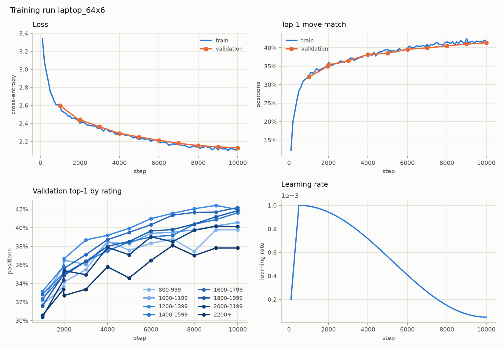

# Progress

See [PLAN.md](PLAN.md) for details on each step.

## Checklist

- [x] 1. Project setup
- [x] 2. Data download + streaming parser
- [x] 3. Board + move encoding
- [x] 4. Dataset builder
- [x] 5. Model
- [x] 6. Training pipeline
- [ ] 7. Evaluation + baselines
- [ ] 8. Bot move selection + CLI
- [ ] 9. Backend API
- [ ] 10. Web UI for playing
- [ ] 11. Elo dial validation
- [ ] 12. Rating estimation
- [ ] 13. Game import
- [ ] 14. Game review engine
- [ ] 15. "Your level vs. next level" + mistake coach
- [ ] 16. Review UI
- [ ] 17. Tiered hints
- [ ] 18. Adaptive difficulty
- [ ] 19. Style imitation + ghost mode
- [ ] 20. Polish

## Step 1: Project setup (done 2026-11-20)

**Built**
- `src/` layout package `chess_engine` with subpackages `data`, `encoding`, `model`, `training`,
  `eval`, `bot`, `review`, `api`. Placeholder modules (docstring only) name the step that fills them in.
- `pyproject.toml` is the single dependency list (installed with `pip install -e ".[dev]"`).
- Config system (`chess_engine.config`): YAML → validated, immutable pydantic models.
- Stockfish utility (`chess_engine.stockfish`): find → verify → clear error with OS-specific install steps.
- `scripts/check_setup.py`: one command that reports Python, packages, config and Stockfish status.
- Tests: imports of every module, config loading and validation, python-chess behaviour, Stockfish
  detection (using a fake UCI engine) and real-Stockfish tests that skip with instructions if it is missing.

**Decisions**
- **pyproject.toml rather than requirements.txt.** One source of truth, and the editable install makes
  `import chess_engine` work from scripts, tests and notebooks without `sys.path` hacks.
  Major versions are pinned to what was installed and tested (`>=tested,<next major`).
- **pandas 3.1.1 excluded.** On this Windows machine, Smart App Control blocked a DLL inside the
  pandas 3.1.1 wheel. 3.1.0 works. Remove the `!=3.1.1` once a newer release installs cleanly.
- **Config = default.yaml + override file.** `default.yaml` holds every setting (laptop-friendly:
  sample mode ON, small model). Other files (e.g. `full.yaml` for Colab/GPU) list only what changes
  and are deep-merged on top. Unknown keys are errors, so typos fail loudly.
- **pydantic for config validation** (rather than bare dataclasses): type checking, range checks and
  readable errors for free, and FastAPI (step 9) uses it anyway.
- **Relative paths resolve against the project root**, not the current directory, so scripts behave
  the same wherever they are launched from.
- **Rating buckets** are lower edges `[800, 1000, ..., 2200]`, giving 8 buckets:
  800–999, …, 2000–2199, 2200+. Games with a player under 800 are filtered out (`min_rating: 800`).
- **Time control** is filtered by Lichess speed category (`speeds: [blitz]`). Lichess defines the
  speed from base + 40 × increment: blitz is 180–479 s. The parser itself is step 2.
- **Excluded terminations**: `Abandoned`, `Rules infraction`, `Unterminated`.
- **Stockfish lookup order**: `STOCKFISH_PATH` env var → `stockfish.path` in config → `PATH` →
  common install locations. A wrong *explicit* path is an error rather than a silent fallback.
  The env var is the recommended way to set a machine-specific path, so committed configs stay portable.
- **Stockfish checks are tested with a fake UCI engine** (`tests/fixtures/fake_uci_engine.py`), so
  the verify logic is covered even on machines without Stockfish.
- Default Lichess month `2024-01` was a placeholder; step 2 chose `2026-10`.

## Step 2: Data download + streaming parser (done 2026-11-23)

**Built**
- `chess_engine.data.pgn_stream`: lazy PGN splitter (`iter_raw_games`), movetext tokenizer
  (`parse_movetext` → SAN moves, per-move `[%clk]` seconds, result), `TimeControl`/speed
  classification, `GameFilter` (built from config), `GameRecord`, `filter_games` and `FilterStats`.
- `chess_engine.data.sources`: open local `.pgn`/`.pgn.zst` or an HTTP(S) URL as a text stream
  decompressed on the fly; `HTTPRangeReader` resumes dropped connections with `Range` requests;
  `download_file` / `download_lichess_month` for full, resumable, SHA-256-verified downloads.
- `chess_engine.data.game_store`: `GameWriter` (Parquet, batched row groups, written to `.tmp`
  and renamed only when complete) and `prepare_games` (source → filter → Parquet + `.stats.json`).
- Scripts: `scripts/prepare_games.py`, `scripts/download_lichess.py`.
- Tests: an anonymized fixture of 16 real games from the 2026-10 dump (every speed + BOT games),
  plus a local HTTP test server with Range support and fault injection (dropped connections,
  503s, servers that ignore Range).

**Real sample run** (`python scripts/prepare_games.py`, default config, streamed from Lichess)

| | |
|---|---|
| Games read | 116,102 (first 36 MB of the ~31 GB 2026-10 file) |
| Games kept | 50,000 (43.1%), 3.54M positions, 10.1 MB Parquet |
| Time | 30 s on a laptop (parser alone: ~4,800 games/s) |
| Rejected: speed (not blitz) | 62,928 |
| Rejected: too short (< 20 plies) | 1,635 |
| Rejected: a player under 800 | 992 |
| Rejected: BOT account | 286 |
| Rejected: abandoned / rules infraction | 208 |
| Rejected: not rated | 53 |
| Time controls kept | 3+0 43%, 5+0 26%, 3+2 19%, 5+3 9% |
| Player-games per bucket | 800: 4.1k · 1000: 8.8k · 1200: 13.4k · 1400: 19.2k · 1600: 21.1k · 1800: 18.7k · 2000: 10.6k · 2200+: 4.2k |

Replaying the first 5,000 kept games with python-chess found 0 illegal moves.

**Decisions**
- **Month 2026-10** (latest complete month). Each file is ~30 GB, but sample mode only streams the
  start, so the month choice costs nothing on a laptop. More months can be listed in config.
- **Sample mode streams straight from the Lichess server** instead of downloading: 50k games need
  ~36 MB of a 31 GB file. Full runs use `download_lichess.py` first (resumable, checksum-verified),
  and `prepare_games.py` automatically uses a downloaded file in `data/raw/` when there is one.
- **Fast header-first filtering, no python-chess in step 2.** Headers are checked before the movetext
  is even tokenized, and moves are kept as SAN without replaying them (python-chess replay runs at
  ~550 games/s, ~9× slower than the parser). Step 4 has to replay every game anyway to get positions,
  so legality is checked there, once.
- **Moves stored as SAN lists, clocks as float seconds**, one row per game. SAN is what the file
  contains (no conversion cost) and is human-readable; step 4 converts while replaying.
- **BOT games excluded** (`exclude_titles: [BOT]`): the model should learn human moves only.
- **Clocks required** (`require_clocks: true`) and all-or-nothing per game: either every move has a
  `[%clk]` or the game is dropped, so step 4 can rely on a clock for every position.
- **"Rated" check**: Swiss events are named `Blitz swiss https://...` with no "Rated" prefix, so a game
  counts as rated if the event starts with "Rated" or it has a `RatingDiff` header. (The first real run
  wrongly rejected 589 rated Swiss games; now 53 remain, Swiss games without rating changes.)
- **Ratings**: both players must be ≥ `min_rating` (and ≤ `max_rating` if set); a `?` rating rejects.
- **Robust streaming**: dropped connections and 5xx errors are retried with exponential backoff and
  resumed at the exact byte, invalid UTF-8 is replaced instead of crashing, outputs are written to
  temporary files and renamed only when complete. Only a generic `User-Agent` is sent.
- **Test fixture is real data, anonymized**: player names and game ids replaced; the data is CC0.

## Step 3: Board + move encoding (done 2026-11-23)

**Built**
- `chess_engine.encoding.moves`: a fixed 1858-move vocabulary (`MOVE_VOCABULARY`), `move_to_index`,
  `index_to_move`, `legal_move_indices`, `legal_move_mask`, `masked_moves`.
- `chess_engine.encoding.board`: `encode_board` → `(20, 8, 8)` planes, `encode_boards` (batch),
  `decode_board` (inverse, for debugging and tests), `PLANE_NAMES` / `PLANE_INDEX`.
- `scripts/benchmark_encoding.py`: times each encoder on positions replayed from the step-2 output.
- Tests run on 312 positions: hand-picked edge cases (Kiwipete for both colours, promotions
  and underpromotions for both colours, en passant for both colours, partial castling rights,
  check, checkmate, stalemate, a 218-move position) plus seeded random games.

**Input planes** (all from the side to move's view)

| Planes | Content |
|---|---|
| 0–5 | my pawns, knights, bishops, rooks, queens, king |
| 6–11 | their pawns … king |
| 12 | white to move (all 1s or all 0s) |
| 13–16 | castling rights: my kingside, my queenside, their kingside, their queenside |
| 17 | en passant target square (only if the capture is legal) |
| 18 | fifty-move counter / 100 (capped at 1) |
| 19 | constant 1s |

**Speed** (`python scripts/benchmark_encoding.py --games 500`, 36,530 real positions, one laptop core):
`encode_board` 18 µs, `legal_move_mask` 96 µs (53 µs of it is python-chess generating legal moves),
`move_to_index` 1 µs, replaying a SAN move 26 µs. About 8,700 positions/s, so the 3.54M positions in
the 50k-game sample take ~7 minutes to encode on one core (step 4 can use several processes).

**Decisions**
- **Side-to-move perspective for both board and moves.** When Black is to move, the board is mirrored
  vertically and the colours swap roles, and Black's moves are mirrored the same way, so the network
  only ever learns "my move" and its policy head is shared between colours. Tested by checking that
  `board` and `board.mirror()` give identical piece planes and identical legal-move indices.
- **A white-to-move plane is still included.** Mirroring makes the colours look the same, but humans
  don't play them the same (opening repertoires, White's extra tempo), so the model can use it.
- **1858-move flat policy** (from→to pairs reachable by a queen or knight move, plus 66 underpromotions),
  the same size as Leela Chess Zero's, rather than AlphaZero's 8×8×73 = 4672 (most of which can never be
  legal). Queen promotion shares the plain from→to index: in any position only one piece can stand on
  the from-square, so there is no ambiguity, and `index_to_move` re-adds the queen promotion when a pawn
  reaches the last rank.
- **Castling = king moves two squares** (`e1g1`), python-chess's standard-chess convention. Chess960
  boards raise an error instead of being silently mis-encoded.
- **En passant only when the capture is legal.** python-chess sets `ep_square` after every double pawn
  push; encoding it only when a capture is possible makes identical positions encode identically.
- **No move history planes for now.** The position itself is enough to start with; history can be added
  as extra planes later without changing the move encoding.
- **Bitboards → planes with `numpy.unpackbits`** instead of looping over squares in Python.
- **`legal_move_mask` vectorized** with numpy lookup tables (121 → 96 µs per position); the rest is
  python-chess's move generator.
- **`encode_board` returns float32 by default**; `fifty_move_clock` is the only fractional plane, so the
  other 19 planes can be stored as bits/uint8 in step 4.

## Step 4: Dataset builder (done 2026-11-23)

**Built**
- `chess_engine.data.splits`: train/val/test assignment from a seeded hash of the game id.
- `chess_engine.encoding.compact`: a 99-byte stored form of a position (12 bitboards + flags + en passant
  + halfmove clock) and `planes_from_compact`, which rebuilds a whole batch of `encode_board` planes with numpy.
- `chess_engine.data.samples`: replays a game into one sample per position (`Samples`, a columnar container
  with ragged legal-move lists, `take`, `concat` and `legal_mask`).
- `chess_engine.data.shards`: `.npz` shard files (versioned, written to `.tmp` then renamed) and
  `ShardWriter`, which shuffles each shard with a fixed seed.
- `chess_engine.data.dataset_builder`: `build_dataset` (games Parquet → shards per split + `games.parquet`
  index + `manifest.json`), parallel across worker processes; the whole directory is built under `.tmp`
  and renamed when complete.
- `chess_engine.data.dataset`: `PositionDataset` reads a split and yields `Batch`es (planes, legal mask,
  target move, features), either fully in memory or one shard at a time.
- Scripts: `scripts/build_dataset.py`, `scripts/inspect_dataset.py` (decodes random samples back into
  boards and moves as a sanity check).

**One sample per position**

| Column | Content |
|---|---|
| `pieces`, `flags`, `ep`, `halfmove` | the board, compact form (decodes to exactly `encode_board`'s 20 planes) |
| `move` | policy index of the move the human played (the target) |
| `legal_count` + shared `legal_moves` | the position's legal moves (rebuilt into the 1858-entry mask per batch) |
| `rating`, `bucket`, `opp_rating` | the mover's rating and bucket, the opponent's rating |
| `clock`, `opp_clock`, `time_spent` | both players' time left before the move, and seconds spent on it |
| `base_seconds`, `increment`, `ply`, `result` | time control, move number, game result for the mover (+1/0/-1) |
| `game` | row in the dataset's `games.parquet` (game id, split, ratings, positions kept) |

**Real build** (`python scripts/build_dataset.py`, the 50k-game sample from step 2)

| Split | Games | Positions | Shards |
|---|---|---|---|
| train | 45,086 | 3,191,533 | 16 |
| val | 2,470 | 176,658 | 1 |
| test | 2,444 | 172,086 | 1 |

- All 50,000 games replayed with **0 illegal moves**, giving 3,540,277 positions, which matches step 2's count.
- **164 MB on disk** (46 bytes/position with zlib) and 189 bytes/position in memory, so the whole training
  split fits in ~0.6 GB of RAM.
- **Took 220 s** with 7 workers on an otherwise idle laptop (~16,000 positions/s). The first build, run while
  other programs kept the CPU ~95% busy, took 703 s with identical output.
- **Worker scaling is limited by the laptop's CPU**: on 5,000 games, 1 worker took 32 s, 4 took 21 s
  and 7 took 22 s. Encoding alone shows why: 37 s of CPU work on 1 worker becomes 70 s in total on 4, so each
  core runs about half as fast once several are busy. The Core Ultra 9 288V is power-limited and has only
  4 performance cores. A desktop or cloud machine with more cores should scale further.
- Loading: the whole training split (3.19M positions) loads in 2.2 s. Batches of 256 decode at
  ~130,000 positions/s (2 ms per batch), far faster than a network will train on a laptop.
- Encoding benchmark on the idle laptop (`benchmark_encoding.py --games 500`): `encode_board` 13.5 µs,
  `legal_move_mask` 42 µs, replay 27 µs per position (~18,000 positions/s per core, 2× the step-3 figures,
  which were also measured on a busy machine).
- 2,000 random test samples were checked against a fresh replay of their games: the planes, legal mask,
  target move and rating all match. The decoded boards look right in `inspect_dataset.py`.
- Positions per bucket (train): 800: 113k · 1000: 253k · 1200: 406k · 1400: 599k · 1600: 678k · 1800: 625k
  · 2000: 366k · 2200+: 152k. The lowest bucket has 6× fewer positions than the biggest. Step 6 should
  weight or resample by bucket so low ratings are not under-learned.
- Average 29.6 legal moves per position; median 2 s spent per move; 9% of positions have under 30 s on the clock.

**Decisions**
- **Split by game with a hash of `(seed, game_id)`**, not a shuffled list: every position of a game is in
  one split, re-running gives the same split, adding games never moves existing ones, and later steps
  (rating estimation on held-out games) can find the test games from their ids alone.
- **Compact boards instead of stored planes**: 99 bytes instead of 5 KB per position. Decoding is a few numpy
  operations per batch and is tested to match `encode_board` exactly on every test position.
- **Legal moves stored as lists, not masks**: ~30 int16s instead of 1858 bits per position, about 3× smaller
  and well compressed; masks are rebuilt per batch.
- **Shuffled within shards when written, then globally when training**: positions of one game are spread
  across a 200k-position shard (~2,800 games), so even shard-by-shard streaming gives well-mixed batches.
- **Clocks before the move** for both players, plus time spent on it. Lichess doesn't run the clock or add
  the increment on each side's first move, so the first two moves count as 0 s spent.
- **Every position is kept by default** (`skip_first_plies: 0`, `min_clock_seconds: 0`). The bot has to
  play openings and time scrambles like a human too; both filters are in the config for experiments.
- **The mover's rating and the opponent's rating are both stored**, plus the bucket. Buckets are also
  recomputable from the rating if the edges change.
- **Parallel encoding with ordered results**: worker processes encode batches of 500 games, results are
  collected in order with a bounded queue, so output is byte-identical for any worker count (tested)
  and memory does not grow with the number of games.
- **Shards are compressed and written on background threads** (zlib releases the GIL), so the main process
  keeps collecting worker results. Compression is ~9 s per 5,000 games on one core. On this laptop it was
  already hidden behind encoding, but it would become the bottleneck on a machine with many cores.
- **NumPy `.npz` shards** (compressed by default; `--no-compress` for faster loading) rather than
  Parquet. Samples are fixed-size numeric arrays that the training loop wants as numpy, and there is
  no per-row overhead.
- **Each dataset records its encoding** (plane names, number of moves, format version) in its manifest, and
  `PositionDataset` refuses to load a dataset built with a different encoding.

## Step 5: Model (done 2026-11-23)

**Built** (`chess_engine.model`)
- `features`: dataset batch → `ModelInputs` (board planes, mover's bucket, opponent's bucket, 5 clock
  features) and `Targets` (played move, legal mask, result as loss/draw/win).
- `layers`: `ConditionEncoder` (rating embedding + opponent embedding + clock features → MLP → one vector
  per position) and `ConditionedResidualBlock` (residual block modulated by that vector).
- `policy_map`: the 1858 vocabulary moves laid out as 73 move types × 64 from-squares (AlphaZero-style),
  so the policy head can be convolutional.
- `heads`: convolutional policy head (default), dense policy head (alternative), win/draw/loss value head.
- `network`: `RatingConditionedNet`, `build_model(cfg)`, `count_parameters`.
- `masking`: illegal moves masked out: `masked_logits`, `legal_probs` (with temperature),
  `legal_log_probs`, `policy_loss` (cross-entropy over legal moves only).
- `inference`: `MovePredictor` (`chess.Board` + rating → every legal move with its probability, plus
  win/draw/loss), `save_model` / `load_model` (weights + config + bucket edges + encoding in one file).
- `scripts/model_summary.py`: parameters per part, CPU speed, estimated epoch time.

**Architecture** (default config)

```
board planes (20x8x8) -> 3x3 conv stem (64) -> 6 residual blocks (64 channels) -> policy head -> 1858 logits
                                                  ^ FiLM in every block          -> value head  -> W/D/L
mover's bucket, opponent's bucket, clocks -> ConditionEncoder -> conditioning vector (64)
```

| Part | Parameters |
|---|---|
| condition encoder | 11,072 |
| stem | 11,648 |
| 6 residual blocks | 493,824 |
| policy head (conv) | 41,737 |
| value head | 74,771 |
| **total** | **633,052** |

**Checks**
- The convolutional head's gather is tested move by move against the raw 73-plane output, and every
  vocabulary move maps to a distinct (move type, square).
- **The network learns what it is for** (tiny models, a few seconds of training each, in `tests/test_model_learning.py`):
  - it memorizes a batch of real positions (over 90% top-1);
  - from the *same* position it learns a different move for each rating bucket, with both `add` and `film`;
  - it learns moves that depend on the opponent's rating combined with the clock;
  - with opponent/clock conditioning turned off it cannot tell those cases apart;
  - the value head learns that the higher-rated player wins.
- Untrained, the rating has no effect on the policy, by design (see decisions); every parameter receives
  gradients.
- `MovePredictor` covers every legal move, including castling, promotions and Black to move, sums to 1,
  gives the same results batched as one by one, and survives a save/load round trip.

**Speed** (`python scripts/model_summary.py --threads 4`, laptop CPU, batch 256): forward pass ~1,450
positions/s, training step ~380 positions/s, so **one epoch over the 3.19M training positions would take
~2.3 h on this laptop**. This is compute-bound (~180 MFLOP per position per training step), not overhead.
For comparison: 48 channels × 4 blocks trains at ~780 positions/s and 32 × 4 at ~1,250.
- 4 torch threads is the fastest setting here (8 is no faster: 4 performance cores).
- Channels-last memory layout gives only ~8%, and bfloat16 training is not supported by this CPU's oneDNN
  build.
- **Implication for step 6:** on the laptop, train on part of an epoch or use a smaller config for quick
  runs; the full sample (and anything bigger) belongs on a GPU (Colab), as PLAN.md anticipated.

**Decisions**
- **FiLM conditioning in every residual block** (default; `add` is available). The rating has to change
  *which* features matter, not just shift them, and putting it in every block lets it act at every depth.
  The modulation layers start at zero, so training starts from a plain ResNet and learns how much the
  rating matters; this keeps early training stable.
- **The opponent's rating and both clocks are inputs too** (both can be turned off in the config). Humans
  play differently against stronger opponents and in time trouble, and the bot needs to imitate that. At
  play time they are set from the actual game (default: equal ratings, full clocks).
- **Clock features are normalized two ways**: a fraction of the starting time *and* log-seconds, so the
  model sees both "used half my time" and "10 seconds left", which mean different things in 3+0 and 5+3.
- **Separate learned embedding per bucket** (8 × 32 numbers): simple, and the training data in every bucket
  is plentiful. Neighbouring buckets are not forced to be similar; that can be revisited if low-data
  buckets look noisy.
- **Convolutional policy head** (73 move types per square, gathered to the 1858 moves): 42k parameters instead
  of 3.8M for a dense head, weights shared across squares, and the spatial structure is kept. The dense
  head is still available (`policy_head: fc`) for comparison in step 7.
- **Value head included** (win/draw/loss for the mover, reading the conditioning too). It is an
  auxiliary training target that helps the trunk learn what matters in a position, and it will be useful for
  game review. Step 6 sets its loss weight.
- **The network outputs unmasked logits**; masking is a separate function, applied identically in the loss,
  in sampling and in inference. Illegal moves get the smallest finite value (not `-inf`), so nothing turns
  into NaN, also in float16.
- **Model files are self-describing and safe**: weights + config + bucket edges + encoding info, loaded with
  `weights_only=True` (an untrusted file cannot run code), and rejected if the encoding differs.

## Step 6: Training pipeline (done 2026-11-24)

**Built** (`chess_engine.training`)
- `device`: device choice (CUDA > MPS > CPU), seeding of every random generator, CPU threads, mixed precision
  (bf16 or fp16 on GPUs, fp32 on CPU).
- `schedule`: linear warmup, then constant / cosine / linear decay to `min_lr_fraction`, as a pure function of the step.
- `balancing`: rating-bucket weights `(n_b / mean)^-power`, normalized so the average weight per position is 1.
- `order`: the epoch's position order from `(seed, epoch)` only: a shuffle, or resampling by bucket.
- `loader`: dataset split -> `TrainBatch` tensors, decoded ahead on a background thread (pinned memory on CUDA).
- `losses`: weighted cross-entropy of the human move over the legal moves (label smoothing over legal moves
  only) + `value_loss_weight` x win/draw/loss cross-entropy.
- `metrics` / `validation`: running means, top-1/3/5 and value accuracy per rating bucket on fixed validation positions.
- `checkpoint`: model + optimizer + scheduler + grad-scaler + counters, written atomically, loaded with
  `weights_only=True`, newest `keep_checkpoints` kept.
- `run_log`: one directory per run (config snapshot, `run.json`, crash-safe `metrics.jsonl`).
- `train`: `Trainer` (validation every `eval_every_steps` and at each epoch end, `best_model.pt` export,
  checkpoints, resume, stop on `max_steps` / `max_minutes` / Ctrl+C) and `history` (curves from the log).
- `chess_engine.plotting`: the shared chart style for report PNGs.
- Scripts: `scripts/train.py`, `scripts/plot_training.py`. Config: the `training:` section, `configs/laptop.yaml`.
- Tests (about 100 new): every module, plus whole-pipeline checks: training lowers the loss and saves a usable model;
  **a run paused mid-epoch or at an epoch boundary and resumed gives bit-identical weights** to an uninterrupted
  run; and games -> dataset -> `Trainer` -> saved model learns that low-rated players open 1.e4 and high-rated
  ones 1.d4 from the identical start position, with both balancing modes.

**Reference run** (`python scripts/train.py --config configs/laptop.yaml --run-name laptop_64x6`, the default
64x6 model, 633k parameters, on the laptop CPU with 4 threads)

| | |
|---|---|
| Training | 10,000 steps x 256 = 2.56M positions (80% of one epoch of the 50k-game sample) |
| Schedule | AdamW, peak learning rate 1e-3 after 500 warmup steps, cosine decay to 5e-5 |
| Balancing | loss weights, power 0.5 (800-999 positions weigh 1.95, 1600-1799 positions 0.80) |
| Speed | 290-500 positions/s, about 2 hours of computing time |
| Sessions | 3: stopped by the time limit at step 1,969, by the session ending at step ~3,100 (resumed from step 3,000) |
| Validation (20k positions) | **top-1 41.4%, top-3 68.6%, top-5 79.6%**, move log-loss 1.931, result guessed 60.1% |
| Best model | the last step: validation loss improved at every check from step 2,000 on |



| Validation, step 10,000 | 800-999 | 1000-1199 | 1200-1399 | 1400-1599 | 1600-1799 | 1800-1999 | 2000-2199 | 2200+ |
|---|---|---|---|---|---|---|---|---|
| top-1 | 39.8% | 40.6% | 42.0% | 41.6% | 42.2% | 41.8% | 40.1% | 37.8% |
| top-5 | 78.2% | 78.6% | 79.7% | 79.3% | 80.7% | 79.8% | 79.4% | 77.0% |

- **No overfitting, and not converged:** training and validation loss lie on top of each other, and validation
  loss was still falling at the end (2.15 -> 2.13 over the last 2,000 steps, at a tiny learning rate). Less than
  one epoch of 50k games is the limit here, not the model: more data and steps (the GPU config) should keep improving it.
- **The rarest buckets are the hardest:** 2200+ (4.8% of the data) is lowest at 37.8% and 800-999 (3.5%) next.
  Balancing gives them 1.7-2x weight per position, but they still see far fewer positions. The step-7 evaluation
  looks at this on the test set with confidence intervals.
- Validation top-1 rose 32.1% (step 1,000) -> 35.0% (2,000) -> 38.2% (4,000) -> 40.0% (7,000) -> 41.4% (10,000).

**Decisions**
- **The data order is a function of `(seed, epoch)`**, so a checkpoint only needs the step counter to rebuild
  the exact batches still to come; there is no data-loader state to save. Together with checkpointing the
  optimizer, scheduler, grad scaler and RNG, a resumed run is bit-identical to an uninterrupted one (tested).
  This mattered in practice: the reference run was resumed twice.
- **A background decoding thread instead of DataLoader worker processes.** A batch decodes in ~2 ms, while a
  training step takes ~700 ms on this CPU, so one thread is plenty. Worker processes would each need a copy of the
  0.6 GB in-memory split, and starting processes is slow on Windows.
- **Bucket balancing by loss weights, power 0.5** (default). Power 1 would weigh an 800-999 position 3.5x;
  0.5 is a middle ground between "as in the data" and "every bucket equal", and normalizing the weights to an
  average of 1 keeps the loss scale and learning rate unchanged. Resampling (`sample`) is available; it changes
  which positions are seen rather than how much each counts.
- **No weight decay on embeddings, biases or batch-norm parameters.** Decaying a rating embedding would pull a
  rarely seen bucket towards "no rating" between its updates.
- **The best model is chosen by validation loss, not top-1.** The bot samples from the probabilities (step 8), so
  how well the whole distribution fits matters more than the favourite move alone.
- **Validation uses the first 20,000 validation positions**, always the same ones, so every check in every
  run is comparable; a pass takes ~15 s.
- **`max_minutes` counts wall-clock time of the session.** The first session lost three hours while the laptop
  slept and stopped at step 1,969 instead of 10,000. The resulting checkpoint made that harmless.
- **The first Ctrl+C stops at the end of the current step** (checkpoint + final model); the second aborts. A
  plain KeyboardInterrupt could land between the optimizer step and the step counter and save an inconsistent state.
- **Mixed precision only on GPUs** (`auto`): bf16 training is not supported by this CPU's oneDNN build, and
  fp16 on CPU is slower than fp32.
- **Tests train real (tiny) models on real (tiny) datasets**, with 2 torch threads and no worker processes, so
  the ~100 training tests take about 2 minutes.
