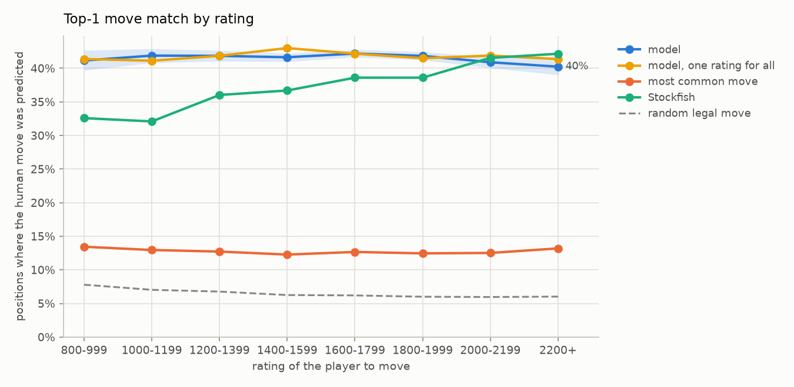

# Human-Like Chess Engine

A chess engine that plays like a **human at a given rating**, not like a perfect machine.
Given a position and a target rating (800–2200+), a neural network trained on millions of real
Lichess blitz games predicts a probability for each legal move: *what would a 1400 actually play here?*
On top of that model sit practical training tools: a bot you can dial to any strength, rating
estimation, free game review, and a "your level vs. next level" coach.

> **Status:** early development. See [PROGRESS.md](PROGRESS.md) for what's done.

## Features (planned)

| | Feature | What it does |
|---|---|---|
| 1 | Human-like move model | Probability for every legal move, conditioned on rating |
| 2 | Custom Elo bot | Play the bot at any rating from 800 to 2200+ |
| 3 | Rating estimation | Estimate a player's rating (with a range) from their games |
| 4 | Game review | Best / Good / Inaccuracy / Mistake / Blunder, accuracy, key moments (Stockfish) |
| 5 | Your level vs. next level | What players at your rating play next to what players +200/+400 play, with evals |
| 6 | Tiered hints | Nudge → point → show move; hinted games are unrated |
| 7 | Adaptive difficulty | Bot rating adjusts between games or live (capped) |
| 8 | Style imitation | Bot plays like a specific player |
| 9 | Ghost mode | Play a past version of yourself, trained on your games up to a date |

## Tech stack

- **Python 3.11**, python-chess, PyTorch, NumPy, pandas, pyarrow (Parquet)
- **Stockfish** for analysis and baselines (installed separately)
- **FastAPI** backend and a lightweight HTML/JS frontend
- **pytest** for tests
- **Data:** the [Lichess open database](https://database.lichess.org/) (CC0), streamed directly from
  compressed `.pgn.zst` files, with a sample mode (first 50k games) for laptops

## Setup

### 1. Python environment

Requires Python 3.11+.

```bash
python3.11 -m venv .venv
# Windows (PowerShell):  .venv\Scripts\Activate.ps1
# macOS / Linux:         source .venv/bin/activate
pip install --upgrade pip
pip install -e ".[dev]"
```

### 2. Stockfish

| OS | Install |
|---|---|
| Windows | `winget install --id Stockfish.Stockfish --source winget`, or download from [stockfishchess.org](https://stockfishchess.org/download/) and unzip |
| macOS | `brew install stockfish` |
| Ubuntu / Debian | `sudo apt install stockfish` (installs to `/usr/games/stockfish`) |
| Google Colab | `!apt-get install -y stockfish` |

The project looks for Stockfish in this order: the `STOCKFISH_PATH` environment variable,
`stockfish.path` in the config, your `PATH`, then common install locations. If it is not found
automatically, set the environment variable:

```bash
# Windows (persists for new terminals)
setx STOCKFISH_PATH "C:\Tools\stockfish\stockfish-windows-x86-64-avx2.exe"
# macOS / Linux
export STOCKFISH_PATH=/usr/games/stockfish
```

### 3. Check everything works

```bash
python scripts/check_setup.py   # Python, packages, config, Stockfish
pytest                          # Stockfish tests are skipped (with instructions) if it isn't installed
```

## Configuration

All settings live in YAML files in [`configs/`](configs/):

- [`default.yaml`](configs/default.yaml): every setting, laptop-friendly (sample mode on, small model)
- [`full.yaml`](configs/full.yaml): full-data GPU run; lists only what differs from the default

Config files are validated into typed objects, so a typo or a bad value fails immediately:

```python
from chess_engine.config import load_config

cfg = load_config("configs/full.yaml")
cfg.ratings.bucket_labels()   # ['800-999', '1000-1199', ..., '2200+']
cfg.data.sample.enabled       # False
```

## Data pipeline

Games come from the [Lichess open database](https://database.lichess.org/). Each monthly file is
~30 GB compressed, so nothing is loaded whole: games are streamed, decompressed on the fly, and
filtered one at a time (blitz only, both players 800+, at least 20 plies, clocks on every move,
no BOT accounts, no abandoned games).

```bash
# Sample mode (default config): streams the first 50k matching games straight from Lichess, ~30 s
python scripts/prepare_games.py

# Quick smoke run / a different month / a local file
python scripts/prepare_games.py --max-games 2000
python scripts/prepare_games.py --month 2026-09 --source path/to/file.pgn.zst

# Full scale: download whole months first (resumable, SHA-256 verified), then process them
python scripts/download_lichess.py --config configs/full.yaml
python scripts/prepare_games.py --config configs/full.yaml
```

Output: `data/processed/games/lichess_<month>[_sample].parquet` (one row per game: players, ratings,
time control, result, SAN moves, clock after each move) plus a `.stats.json` with how many games
were kept and why the rest were rejected.

```python
from chess_engine.data.game_store import read_games
games = read_games("data/processed/games/lichess_2026-10_sample.parquet")
```

## Board and move encoding

Positions and moves are encoded **from the side to move's point of view** (Black's positions are
mirrored), so the network always answers "what would I play here?".

```python
import chess
from chess_engine.encoding import encode_board, legal_move_mask, move_to_index, index_to_move

board = chess.Board()
planes = encode_board(board)          # (20, 8, 8) float32: 12 piece planes + turn, castling, en passant, ...
mask = legal_move_mask(board)         # (1858,) bool: True for the 20 legal moves
i = move_to_index(chess.Move.from_uci("e2e4"), board.turn)
index_to_move(i, board)               # Move.from_uci('e2e4')
```

The 1858 policy indices cover every from-to square pair a queen or knight move can reach,
plus underpromotions. See [PROGRESS.md](PROGRESS.md) for the plane layout and the design choices.

## Training dataset

Turns the filtered games into one sample per position (board, move played, the mover's rating and
bucket, both clocks, time spent, result), split into train/val/test **by game**, so no game appears
in two splits.

```bash
python scripts/build_dataset.py              # after prepare_games.py; the 50k sample takes ~4 min
python scripts/inspect_dataset.py            # summary + a few samples decoded back into boards
```

Output goes to `data/processed/datasets/lichess_<month>_sample/` (`manifest.json`, `games.parquet`,
`train/`, `val/`, `test/` shards). Reading it for training:

```python
from chess_engine.data.dataset import PositionDataset

train = PositionDataset("data/processed/datasets/lichess_2026-10_sample", "train")
for batch in train.iter_batches(batch_size=256, shuffle=True, seed=0):
    batch.planes, batch.legal_mask, batch.move, batch.features["bucket"]
```

## Model

A ResNet over the board planes whose every residual block is modulated (FiLM) by a learned embedding of
the mover's rating bucket, the opponent's bucket and the clocks. It outputs logits for all 1858 moves
(illegal ones are masked out) and a win/draw/loss estimate. The default size is 64 channels × 6 blocks,
633k parameters.

```python
import chess
from chess_engine.config import load_config
from chess_engine.model import MovePredictor, build_model, load_model

cfg = load_config()
predictor = MovePredictor(build_model(cfg), cfg.ratings)      # or load_model("model.pt").predictor()
for p in predictor.predict(chess.Board(), rating=1500)[:3]:
    print(p.san, f"{p.prob:.1%}")
```

```bash
python scripts/model_summary.py        # parameters, speed on this machine, estimated epoch time
```

## Training

Training is driven by the `training:` section of the config: AdamW with linear warmup and cosine decay,
gradient clipping, mixed precision on GPUs, and rating-bucket balancing so the rarer low and high ratings
are not under-learned. Batches are decoded on a background thread.

```bash
python scripts/train.py --config configs/laptop.yaml --run-name laptop_64x6   # the ~2 h CPU reference run
python scripts/train.py --max-minutes 60 --threads 4                         # any run, stopped after an hour
python scripts/train.py --config configs/full.yaml --run-name full_v1        # GPU / Colab
python scripts/train.py --resume laptop_64x6                                 # continue exactly where it stopped
python scripts/plot_training.py laptop_64x6                                 # curves -> reports/training/
```

Each run gets a directory `checkpoints/<run>/` with the config it was started with, a `metrics.jsonl` log
(train and validation lines, readable while the run is going), step checkpoints for resuming,
`best_model.pt` (lowest validation loss) and `final_model.pt`. A run stops cleanly, with a checkpoint,
when its epochs are done, at `max_steps`, after `max_minutes`, or on the first Ctrl+C. Resuming
continues bit-for-bit as if the run had never stopped (this is tested).

```python
from chess_engine.model import load_model
predictor = load_model("checkpoints/laptop_64x6/best_model.pt").predictor()
```

## Evaluation

How often does the model predict the move a human actually played, at each rating, on games it never saw?

```bash
python scripts/evaluate.py laptop_64x6                  # the run's best model on the test split (~9 min on a laptop)
python scripts/evaluate.py laptop_64x6 --no-stockfish --max-positions 20000   # quick look
python scripts/compare_models.py checkpoints/laptop_64x6/best_model.pt checkpoints/laptop_64x6/final_model.pt
```

The evaluation writes `reports/eval/<run>_<model>/`: a Markdown `report.md`, `results.json` and four charts.
It reports top-1/3/5 move match and log-likelihood per rating bucket with 95% confidence intervals (bootstrap
over whole games), and compares against these baselines:

- **most common move**: the move played most often in that exact position in the training games, overall or
  at the same rating, with a random legal move where the position never occurred;
- **Stockfish's best move** (depth 10, on a 10,000-position sample; skipped if Stockfish is not installed);
- **the same model told one fixed rating for everyone**, to measure what rating conditioning adds;
- **a random legal move**.

It also shows a cross-rating matrix (which rating best predicts each group of players), accuracy by game
phase and clock, and calibration of the move probabilities and of the win/draw/loss head.

**Current results** (the 64x6 model after ~2 hours of CPU training on 2.56M positions; [full report](reports/eval/laptop_64x6_best_model/report.md)):
41.7% top-1 / 79.6% top-5 on 172k held-out positions, vs. 37.6% for Stockfish's best move, 12.6% for the most
common move in the training games and 6.3% for a random legal move. The model beats Stockfish by 9-10 points at
800-1199 and ties it around 2000. Rating conditioning is still weak: telling the model a player's real rating
does not yet beat telling it one rating for everyone (both 42.0%). See [PROGRESS.md](PROGRESS.md).



## Project structure

```
configs/              YAML configs
src/chess_engine/
  config.py           typed config loading
  stockfish.py        find + verify Stockfish
  data/               Lichess streaming + filtering, Parquet game store, dataset builder
  encoding/           board -> tensor, move <-> index
  model/              rating-conditioned policy network
  training/           training loop, checkpoints, metrics log
  eval/               move-match accuracy, baselines, calibration (later: Elo validation, rating estimation)
  bot/                move selection, hints, adaptive difficulty, styles
  review/             Stockfish game review, level comparison
  api/                FastAPI backend
web/                  frontend
scripts/              command-line entry points
tests/                pytest suite
reports/              generated plots and result tables
data/, checkpoints/   local only (git-ignored)
```

## Roadmap

The full 20-step build plan is in [PLAN.md](PLAN.md); progress and design decisions are in [PROGRESS.md](PROGRESS.md).

## Data & license notes

Game data comes from the Lichess open database, released under CC0. Stockfish is GPL-3.0 and is
installed separately (it is not bundled with this repo).
