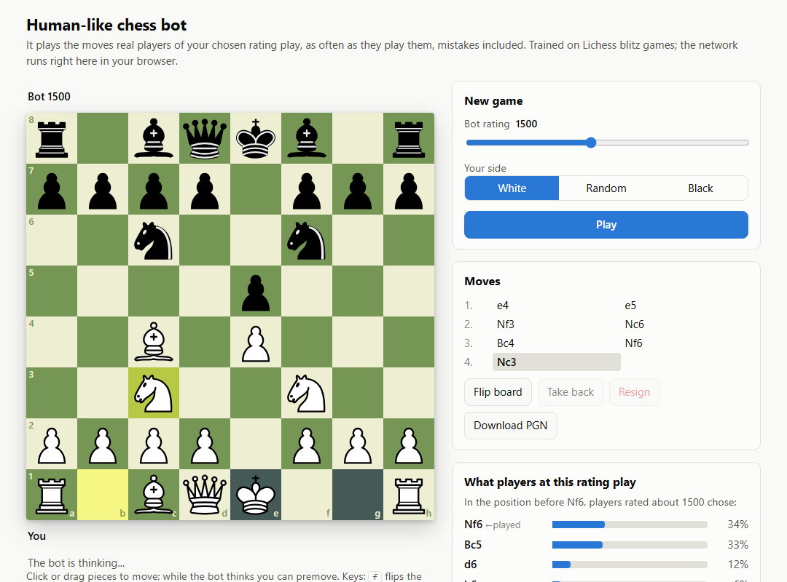
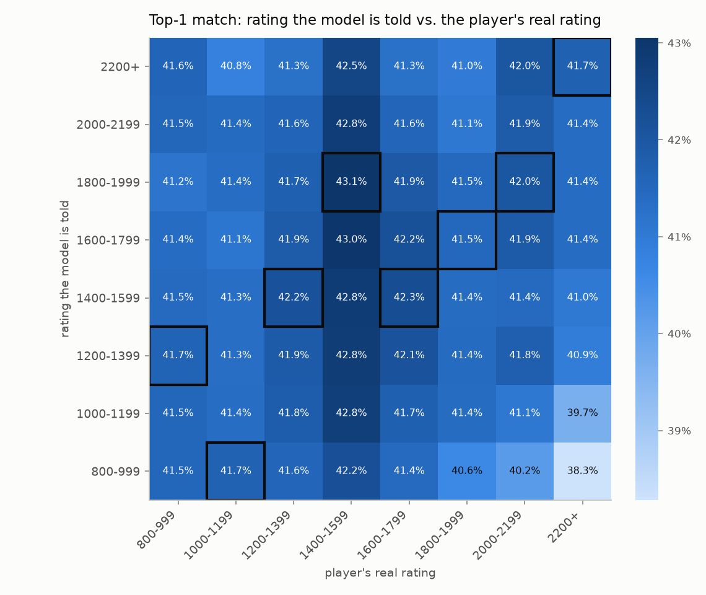
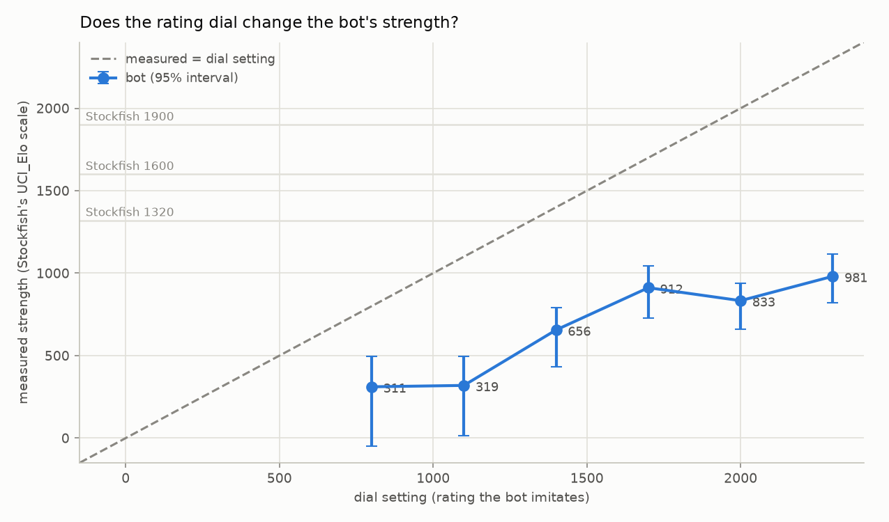
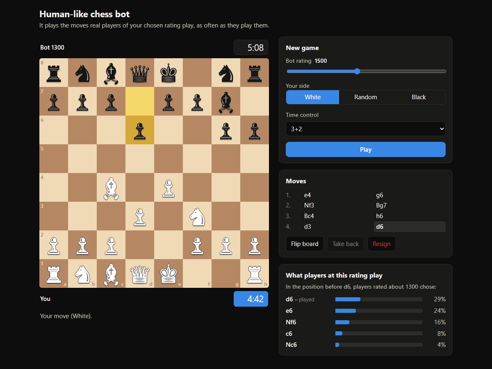
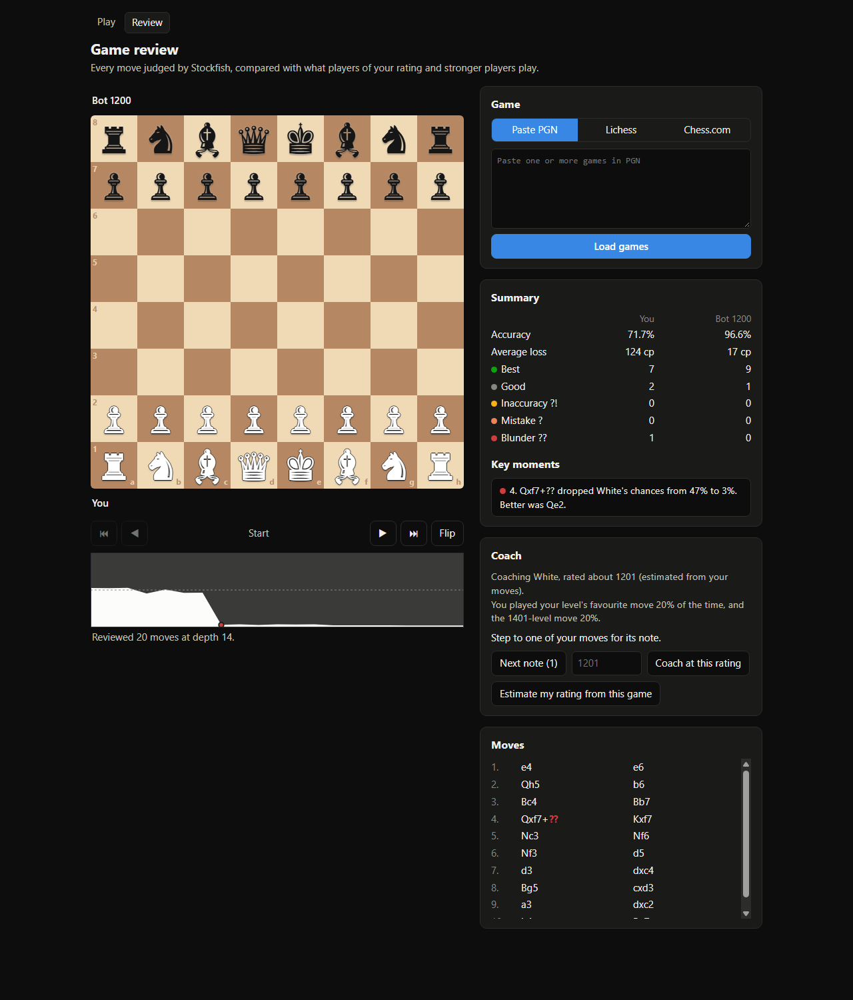
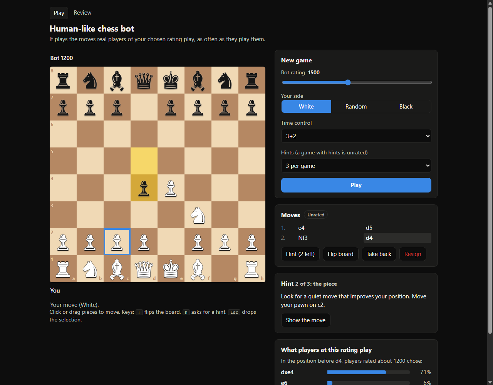
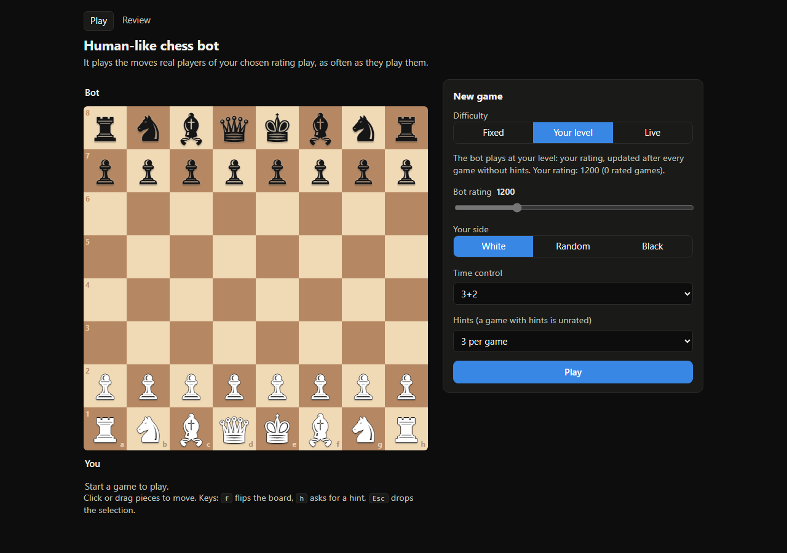

# Human-Like Chess Engine

**🔗 Live site: [yatharthjag2008.github.io/Chess_Engine](https://yatharthjag2008.github.io/Chess_Engine/)**. Play the
bot at any rating from 800 to 2400 and see what players of that rating would play; the neural network runs in your
browser, no install needed.

On the website: clocks (1, 3, 5 or 10 minutes; the bot thinks like a human and feels time pressure), premoves,
sound effects (on/off and volume), captured pieces and the material lead, arrows and circles (right-click), the opening's name,
stepping back through the game (arrow keys), games that survive a reload, take back, resign and PGN download.

[](https://yatharthjag2008.github.io/Chess_Engine/)

The full app (game review, hints, the coach, adaptive difficulty, styles) needs Stockfish and runs on your own
computer: `python scripts/serve.py`, then open [http://127.0.0.1:8000](http://127.0.0.1:8000) (setup below).

A chess engine that plays like a **human at a given rating**, not like a perfect machine.
Given a position and a target rating (800–2200+), a neural network trained on millions of real
Lichess blitz games predicts a probability for each legal move: *what would a 1400 actually play here?*
On top of that model sit practical training tools: a bot you can dial to any strength, rating
estimation, free game review, and a "your level vs. next level" coach.

> **Status:** all 20 steps of the [plan](PLAN.md) are built and tested (over 1,000 tests). The model is a
> laptop-sized first version: it predicts human moves well, but its sense of *rating* is still weak (see
> [Results](#results-at-a-glance)). Design decisions and every measurement are in [PROGRESS.md](PROGRESS.md);
> to run it for yourself or others, see [DEPLOY.md](DEPLOY.md).

## Features

| | Feature | Try it | Where |
|---|---|---|---|
| 1 | Human-like move model: a probability for every legal move, conditioned on rating and clocks | `python scripts/evaluate.py laptop_64x6` | [Evaluation](#evaluation) |
| 2 | A bot at any rating from 800 to 2200+ | the browser, or `python scripts/play.py --rating 1400` | [Play in the browser](#play-in-the-browser) |
| 3 | Rating estimation, with a range, from your games | `python scripts/estimate_rating.py games.pgn --player You` | [Estimate a rating](#estimate-a-rating-from-games) |
| 4 | Game review: best / good / inaccuracy / mistake / blunder, accuracy, key moments (Stockfish) | the Review page, or `scripts/review_game.py` | [Review a game](#review-a-game) |
| 5 | Your level vs. next level, and a mistake coach | the Review page's coach, or `scripts/coach_game.py` | [Your level vs. next level](#your-level-vs-next-level) |
| 6 | Tiered hints: nudge, then the piece, then the move; hinted games are unrated | the Hint button, or `hint` in the terminal | [Hints](#hints) |
| 7 | Adaptive difficulty: between games (Elo) or live within a game (capped) | Difficulty in the browser, or `--adaptive` | [Adaptive difficulty](#adaptive-difficulty) |
| 8 | Style imitation: the bot plays like a specific player | `scripts/train_style.py`, then Style in the browser | [Styles and ghosts](#styles-and-ghosts) |
| 9 | Ghost mode: play yourself as you were up to a date | `scripts/train_style.py --until 2025-05-31` | [Styles and ghosts](#styles-and-ghosts) |
| 10 | Import games from Lichess and Chess.com | the Review page, or `scripts/import_games.py` | [Import your games](#import-your-games) |
| 11 | Play on Lichess as a BOT account (optional) | `scripts/lichess_bot.py` | [DEPLOY.md](DEPLOY.md#4-on-lichess-optional) |

## Results at a glance

Measured on the laptop model (64 channels × 6 residual blocks, about 2 hours of CPU training on 2.56M positions
from one month of Lichess blitz). Each row links to the full report or to the step in PROGRESS.md.

| Question | Result |
|---|---|
| Does it predict the human move? | **41.7%** top-1 / 79.6% top-5 on 172k held-out positions; Stockfish's best move 37.6%, the most common move 12.6%, random 6.3% ([report](reports/eval/laptop_64x6_best_model/report.md)) |
| Is it better than Stockfish at imitating people? | yes below 2000: +9 to +10 points at 800-1199, a tie around 2000 |
| Does the rating dial change its strength? | yes, in steps: rank correlation 0.94, but 800 ≈ 1100 and 2000 ≈ 1700 ([report](reports/elo/laptop_64x6_best_model/report.md)) |
| Can it estimate a rating from one game? | weakly: 253 Elo average error, pulled towards the middle ([report](reports/rating/laptop_64x6_best_model/report.md)) |
| Do hints adapt to how hard a move is? | yes: moves the player found had a median 54% find rate at their rating, missed ones 6.5% (step 17) |
| Does adaptive difficulty find a balance? | yes, in the model's own units: a bot fixed at 1000 balances the adaptive bot at 1400-1450 (step 18) |
| Do styles imitate a player better? | a little, even from 25 games: held-out loss lower for 8 of 10 real players, top-1 +1.8 points (step 19) |

**The main limitation is the model's sense of rating.** It plays and predicts like a human, but it plays nearly
the same way at every rating, so the dial changes style more than strength, estimates are pulled to the middle
and "next level" moves rarely differ. The fix is more training on more data: `configs/full.yaml` (a bigger model
on a GPU) is ready for that, and every tool above improves with the model without code changes.


## Tech stack

- **Python 3.11**, python-chess, PyTorch, NumPy, pandas, pyarrow (Parquet)
- **Stockfish** for analysis and baselines (installed separately)
- **FastAPI** backend and a lightweight HTML/JS frontend
- **pytest** for tests
- **Data:** the [Lichess open database](https://database.lichess.org/) (CC0), streamed directly from
  compressed `.pgn.zst` files, with a sample mode (first 50k games) for laptops

## Setup

### 1. Python environment

Requires Python 3.11+.

```bash
python3.11 -m venv .venv
# Windows (PowerShell):  .venv\Scripts\Activate.ps1
# macOS / Linux:         source .venv/bin/activate
pip install --upgrade pip
pip install -e ".[dev]"
```

### 2. Stockfish

| OS | Install |
|---|---|
| Windows | `winget install --id Stockfish.Stockfish --source winget`, or download from [stockfishchess.org](https://stockfishchess.org/download/) and unzip |
| macOS | `brew install stockfish` |
| Ubuntu / Debian | `sudo apt install stockfish` (installs to `/usr/games/stockfish`) |
| Google Colab | `!apt-get install -y stockfish` |

The project looks for Stockfish in this order: the `STOCKFISH_PATH` environment variable,
`stockfish.path` in the config, your `PATH`, then common install locations. If it is not found
automatically, set the environment variable:

```bash
# Windows (persists for new terminals)
setx STOCKFISH_PATH "C:\Tools\stockfish\stockfish-windows-x86-64-avx2.exe"
# macOS / Linux
export STOCKFISH_PATH=/usr/games/stockfish
```

### 3. Check everything works

```bash
python scripts/check_setup.py   # Python, packages, config, Stockfish
pytest                          # Stockfish tests are skipped (with instructions) if it isn't installed
```

## Configuration

All settings live in YAML files in [`configs/`](configs/):

- [`default.yaml`](configs/default.yaml): every setting, laptop-friendly (sample mode on, small model)
- [`full.yaml`](configs/full.yaml): full-data GPU run; lists only what differs from the default

Config files are validated into typed objects, so a typo or a bad value fails immediately:

```python
from chess_engine.config import load_config

cfg = load_config("configs/full.yaml")
cfg.ratings.bucket_labels()   # ['800-999', '1000-1199', ..., '2200+']
cfg.data.sample.enabled       # False
```

## Data pipeline

Games come from the [Lichess open database](https://database.lichess.org/). Each monthly file is
~30 GB compressed, so nothing is loaded whole: games are streamed, decompressed on the fly, and
filtered one at a time (blitz only, both players 800+, at least 20 plies, clocks on every move,
no BOT accounts, no abandoned games).

```bash
# Sample mode (default config): streams the first 50k matching games straight from Lichess, ~30 s
python scripts/prepare_games.py

# Quick smoke run / a different month / a local file
python scripts/prepare_games.py --max-games 2000
python scripts/prepare_games.py --month 2026-09 --source path/to/file.pgn.zst

# Full scale: download whole months first (resumable, SHA-256 verified), then process them
python scripts/download_lichess.py --config configs/full.yaml
python scripts/prepare_games.py --config configs/full.yaml
```

Output: `data/processed/games/lichess_<month>[_sample].parquet` (one row per game: players, ratings,
time control, result, SAN moves, clock after each move) plus a `.stats.json` with how many games
were kept and why the rest were rejected.

```python
from chess_engine.data.game_store import read_games
games = read_games("data/processed/games/lichess_2026-10_sample.parquet")
```

## Board and move encoding

Positions and moves are encoded **from the side to move's point of view** (Black's positions are
mirrored), so the network always answers "what would I play here?".

```python
import chess
from chess_engine.encoding import encode_board, legal_move_mask, move_to_index, index_to_move

board = chess.Board()
planes = encode_board(board)          # (20, 8, 8) float32: 12 piece planes + turn, castling, en passant, ...
mask = legal_move_mask(board)         # (1858,) bool: True for the 20 legal moves
i = move_to_index(chess.Move.from_uci("e2e4"), board.turn)
index_to_move(i, board)               # Move.from_uci('e2e4')
```

The 1858 policy indices cover every from-to square pair a queen or knight move can reach,
plus underpromotions. See [PROGRESS.md](PROGRESS.md) for the plane layout and the design choices.

## Training dataset

Turns the filtered games into one sample per position (board, move played, the mover's rating and
bucket, both clocks, time spent, result), split into train/val/test **by game**, so no game appears
in two splits.

```bash
python scripts/build_dataset.py              # after prepare_games.py; the 50k sample takes ~4 min
python scripts/inspect_dataset.py            # summary + a few samples decoded back into boards
```

Output goes to `data/processed/datasets/lichess_<month>_sample/` (`manifest.json`, `games.parquet`,
`train/`, `val/`, `test/` shards). Reading it for training:

```python
from chess_engine.data.dataset import PositionDataset

train = PositionDataset("data/processed/datasets/lichess_2026-10_sample", "train")
for batch in train.iter_batches(batch_size=256, shuffle=True, seed=0):
    batch.planes, batch.legal_mask, batch.move, batch.features["bucket"]
```

## Model

A ResNet over the board planes whose every residual block is modulated (FiLM) by a learned embedding of
the mover's rating bucket, the opponent's bucket and the clocks. It outputs logits for all 1858 moves
(illegal ones are masked out) and a win/draw/loss estimate. The default size is 64 channels × 6 blocks,
633k parameters.

```python
import chess
from chess_engine.config import load_config
from chess_engine.model import MovePredictor, build_model, load_model

cfg = load_config()
predictor = MovePredictor(build_model(cfg), cfg.ratings)      # or load_model("model.pt").predictor()
for p in predictor.predict(chess.Board(), rating=1500)[:3]:
    print(p.san, f"{p.prob:.1%}")
```

```bash
python scripts/model_summary.py        # parameters, speed on this machine, estimated epoch time
```

## Training

Training is driven by the `training:` section of the config: AdamW with linear warmup and cosine decay,
gradient clipping, mixed precision on GPUs, and rating-bucket balancing so the rarer low and high ratings
are not under-learned. Batches are decoded on a background thread.

```bash
python scripts/train.py --config configs/laptop.yaml --run-name laptop_64x6   # the ~2 h CPU reference run
python scripts/train.py --max-minutes 60 --threads 4                         # any run, stopped after an hour
python scripts/train.py --config configs/full.yaml --run-name full_v1        # GPU / Colab
python scripts/train.py --resume laptop_64x6                                 # continue exactly where it stopped
python scripts/plot_training.py laptop_64x6                                 # curves -> reports/training/
```

Each run gets a directory `checkpoints/<run>/` with the config it was started with, a `metrics.jsonl` log
(train and validation lines, readable while the run is going), step checkpoints for resuming,
`best_model.pt` (lowest validation loss) and `final_model.pt`. A run stops cleanly, with a checkpoint,
when its epochs are done, at `max_steps`, after `max_minutes`, or on the first Ctrl+C. Resuming
continues bit-for-bit as if the run had never stopped (this is tested).

```python
from chess_engine.model import load_model
predictor = load_model("checkpoints/laptop_64x6/best_model.pt").predictor()
```

## Evaluation

How often does the model predict the move a human actually played, at each rating, on games it never saw?

```bash
python scripts/evaluate.py laptop_64x6                  # the run's best model on the test split (~9 min on a laptop)
python scripts/evaluate.py laptop_64x6 --no-stockfish --max-positions 20000   # quick look
python scripts/compare_models.py checkpoints/laptop_64x6/best_model.pt checkpoints/laptop_64x6/final_model.pt
```

The evaluation writes `reports/eval/<run>_<model>/`: a Markdown `report.md`, `results.json` and four charts.
It reports top-1/3/5 move match and log-likelihood per rating bucket with 95% confidence intervals (bootstrap
over whole games), and compares against these baselines:

- **most common move**: the move played most often in that exact position in the training games, overall or
  at the same rating, with a random legal move where the position never occurred;
- **Stockfish's best move** (depth 10, on a 10,000-position sample; skipped if Stockfish is not installed);
- **the same model told one fixed rating for everyone**, to measure what rating conditioning adds;
- **a random legal move**.

It also shows a cross-rating matrix (which rating best predicts each group of players), accuracy by game
phase and clock, and calibration of the move probabilities and of the win/draw/loss head.

**Current results** (the 64x6 model after ~2 hours of CPU training on 2.56M positions; [full report](reports/eval/laptop_64x6_best_model/report.md)):
41.7% top-1 / 79.6% top-5 on 172k held-out positions, vs. 37.6% for Stockfish's best move, 12.6% for the most
common move in the training games and 6.3% for a random legal move. The model beats Stockfish by 9-10 points at
800-1199 and ties it around 2000. Rating conditioning is still weak: telling the model a player's real rating
does not yet beat telling it one rating for everyone (both 42.0%). See [PROGRESS.md](PROGRESS.md).



## Does the rating dial work?

```bash
python scripts/elo_validation.py      # bots at 800-2300 vs. Stockfish levels and each other (~30 min, resumable)
```

Bots set to different ratings play Stockfish at fixed `UCI_Elo` levels and each other; a Stockfish judge ends
decided games, and the results are fitted to Elo ratings with confidence intervals. With the current model,
**strength rises with the dial** (rank correlation 0.94), but in steps: 1100 -> 1400 -> 1700 are clearly
different, 800 and 1100 play alike, and 2000 measured no stronger than 1700. All bots are much weaker than
Stockfish's weakest setting. [Report](reports/elo/laptop_64x6_best_model/report.md).



## Review a game

```bash
python scripts/review_game.py game.pgn                     # accuracy, mistakes, key moments, move list
python scripts/review_game.py --lichess YourName           # your latest Lichess game
python scripts/review_game.py game.pgn --annotated out.pgn # a PGN with evaluations and ?! ? ?? for any viewer
```

Stockfish analyses every position (depth 14 by default); each move is judged by how much of the mover's winning
chances it gave away (Lichess's method): best, good, inaccuracy, mistake or blunder, with an accuracy per player
and the 3-5 key moments. A typical blitz game takes about a minute on a laptop; reviews are cached. The API offers
`POST /api/review` and `GET /api/games/{id}/review`.

## Your level vs. next level

```bash
python scripts/coach_game.py game.pgn --player YourName     # mistakes explained + where stronger players differ
python scripts/coach_game.py --lichess YourName             # your latest Lichess game
```

For each of your moves the model shows what players of your rating usually play and what players 200 and 400
points higher play; Stockfish values both, and only positions where the levels disagree **and** the difference
matters are shown, with a short explanation. Mistakes get template explanations (missed mate, a piece left hanging,
missed material, or the better move with its evaluation). With the current model the levels rarely disagree, so
most advice comes from the mistake coach; see [PROGRESS.md](PROGRESS.md). API: `POST /api/coach`.

## Import your games

```bash
python scripts/import_games.py --lichess YourName                  # your recent games, saved as one PGN
python scripts/import_games.py --chesscom YourName --speed blitz --rated --max 50
python scripts/import_games.py --pgn games.pgn                      # or a PGN file
python scripts/import_games.py --lichess YourName --estimate        # plus a rating estimate from your moves
```

Games come from the public Lichess and Chess.com APIs (no login needed; only standard chess; cached for 30
minutes). The API server offers the same: `POST /api/import/pgn`, `GET /api/import/lichess/{name}`,
`GET /api/import/chess.com/{name}`, and `POST /api/rating-estimate`. Note: in a live check Chess.com refused
the request (see [PROGRESS.md](PROGRESS.md)); Lichess works.

## Estimate a rating from games

```bash
python scripts/estimate_rating.py my_games.pgn --player MyName      # estimate + 80% range, overall and per game
python scripts/evaluate_rating_estimation.py                        # how accurate is it on held-out games?
```

Every move is scored at every rating; the evidence of a game (or several) is combined with a prior over ratings
into an estimate with a likely range. With the current model the estimate is **weak**: from one game it is off by
253 Elo on average and is pulled towards the middle (low ratings estimated too high, high ratings too low), only a
little better than guessing the average rating, and far worse than guessing the opponent's rating (61 Elo).
See the [report](reports/rating/laptop_64x6_best_model/report.md).

## Play the bot

```bash
python scripts/play.py --rating 1200                       # untimed, you are White
python scripts/play.py --rating 1800 --color black --time 3+2 --show-thinking
python scripts/play.py --temperature 0.5                   # the bot sticks closer to the most common moves
python scripts/bot_match.py --ratings 900 1500 2100        # bots of different ratings play each other
```

The bot plays each move as often as humans at its rating play it in that position (the `bot:` section of the
config sets the model file, rating and sampling: temperature, top-k, top-p, a minimum probability). It is
also told the opponent's rating and both clocks, like the human games it learned from. Type moves in SAN
(`Nf3`) or UCI (`g1f3`); `help`, `undo`, `flip`, `moves`, `resign` and `quit` work during the game, and
`--save-pgn` keeps the game. With `--show-thinking` the bot shows what players of its rating usually play:

```
Bot plays 3... h6
  (players rated ~1200 here: Nf6 36%, Bc5 29%, d6 12%; it played a move they choose 6% of the time)
```

```python
from chess_engine.bot import load_bot
from chess_engine.config import load_config
bot = load_bot(load_config(), rating=1400)
choice = bot.choose_move(board)          # choice.move, choice.san, choice.prob, choice.candidates
```

## Play in the browser

```bash
python scripts/serve.py          # then open http://127.0.0.1:8000
```

Pick the difficulty (a fixed rating, your level, or live), your side, a time control and how many hints you want,
then click or drag pieces (while the bot thinks you can premove: the move is played as soon as it is your turn,
if it is still legal). After each bot move the side panel shows what players of that rating usually choose
in that position. Games can be resigned, taken back (untimed games), downloaded as PGN and reviewed; reloading
the page continues the game. The screenshot shows a hint's first tier and the Unrated badge it brings.



The **Review** page (`http://127.0.0.1:8000/review.html`, or "Review this game" after a game against the bot)
reviews a pasted PGN or your recent Lichess / Chess.com games: step through the moves with Stockfish's verdict on
each, the better move shown on the board, an eval graph, accuracy per player, key moments and the coach's notes on
your moves (with an estimate of the rating you played at).



## Hints

Stuck? Ask for a hint, in the browser (the Hint button, or `h`) or in the terminal (`hint`). Each hint goes one
step further: a **nudge** (what kind of move to look for), then **the piece** to move (its square is marked), then
**the move** itself. The nudge is vaguer when players at your rating usually find the move, and more specific
when they rarely do. Hints come from Stockfish and need it installed. A game has 3 hints by default (choose 0-20
in the new-game form or with `--hints N`), and any hint makes the game unrated (its PGN says so).

```bash
python scripts/hint.py --fen "<FEN>" --rating 1200                     # all three tiers for a position
python scripts/hint.py --pgn game.pgn --color black --rating 1100     # what each hint would have said
```



## Adaptive difficulty

Choose **Your level** in the new-game form (or `python scripts/play.py --adaptive between`) and the bot plays at
your rating, updated like Elo after every game without hints, so you should win about half your games. **Live**
(`--adaptive live`) starts at the rating you pick and adapts during the game, at most 200 points either way. The
bot's current rating is always shown next to its name. Your rating is kept in `data/adaptive.json` (reset it from
`POST /api/adaptive/reset`, or delete the file).

```bash
python scripts/adaptive_sim.py --player stockfish:1500 --mode between --games 30   # try it on a known player
```

With the current model the rating it settles on is in the bot's own units: the dial changes the bot's style more
than its strength (see PROGRESS.md, steps 11 and 18).



## Styles and ghosts

Make the bot play like a particular player, or like yourself as you played until some date (a **ghost**):

```bash
python scripts/train_style.py --pgn games.pgn --player "Some Player" --name some-player
python scripts/train_style.py --lichess YourName --name me-may --until 2025-05-31   # your past self
python scripts/train_style.py --list
python scripts/play.py --style some-player          # or pick it under Style in the browser
python scripts/evaluate_styles.py --pgn games.pgn --top 10   # does a style beat the rating model?
```

A style is a small adapter (a few thousand numbers) on top of the rating model, trained in seconds to a minute on
a CPU; it needs at least 5 games, and with fewer than 200 it is blended with the rating model so it only leans
towards the player's habits. On 10 real players with 24-72 games each, styles predicted the players' moves on
unseen games better for 8 of them (top-1 +1.8 points on average; PROGRESS.md, step 19).

## API server

The same server also exposes the JSON API (interactive docs at `/docs`):

A small FastAPI backend for playing the bot from other programs (and the web UI): start a game with a rating,
colour and optional time control, send moves, and get the bot's reply, legal moves, clocks and result back as JSON.

```bash
curl -X POST localhost:8000/api/games -H "Content-Type: application/json" -d '{"rating": 1200, "time_control": "5+0"}'
curl -X POST localhost:8000/api/games/<id>/moves -H "Content-Type: application/json" -d '{"move": "e4"}'
```

Endpoints: `GET /api/health`, `POST /api/games`, `GET /api/games/{id}`, `GET .../legal-moves`, `POST .../moves`,
`POST .../bot-move`, `POST .../resign`, `POST .../takeback`, `GET .../pgn`. See [PROGRESS.md](PROGRESS.md) for
the full table and error codes.

## Project structure

```
configs/              YAML configs
src/chess_engine/
  config.py           typed config loading
  stockfish.py        find + verify Stockfish
  data/               Lichess streaming + filtering, Parquet game store, dataset builder
  encoding/           board -> tensor, move <-> index
  model/              rating-conditioned policy network
  training/           training loop, checkpoints, metrics log
  eval/               move-match accuracy, baselines, calibration, Elo validation, rating estimation
  bot/                move sampling, games + clocks, terminal play, self-play, hints, adaptive difficulty
  review/             Stockfish game review, level comparison
  style/              style adapters: imitate a player, or yourself up to a date (ghost)
  api/                FastAPI backend (schemas, game store, service, app)
  lichess_bot.py      play on a Lichess BOT account (optional)
web/                  browser play and review pages (plain HTML/CSS/JS, no build step)
DEPLOY.md             running it on your network, a server or Lichess
scripts/              command-line entry points
tests/                pytest suite
reports/              generated plots and result tables
data/, checkpoints/   local only (git-ignored)
```

## Roadmap

The 20-step build plan is in [PLAN.md](PLAN.md) (all done); progress, measurements and design decisions are in
[PROGRESS.md](PROGRESS.md). The next step is not more features: it is training the full model
(`configs/full.yaml`) so that the rating dial, rating estimation and "next level" advice get sharper.

## Data & license notes

Game data comes from the Lichess open database, released under CC0. Stockfish is GPL-3.0 and is
installed separately (it is not bundled with this repo).

The website bundles [chess.js](https://github.com/jhlywa/chess.js) (BSD-2, `site/vendor/`). The chess pieces in
`web/pieces/` are the cburnett set by Colin M.L. Burnett (GPLv2+, see `web/pieces/LICENSE.txt`). Opening names come
from the [Lichess opening data set](https://github.com/lichess-org/chess-openings) (CC0, `third_party/chess-openings/`).
