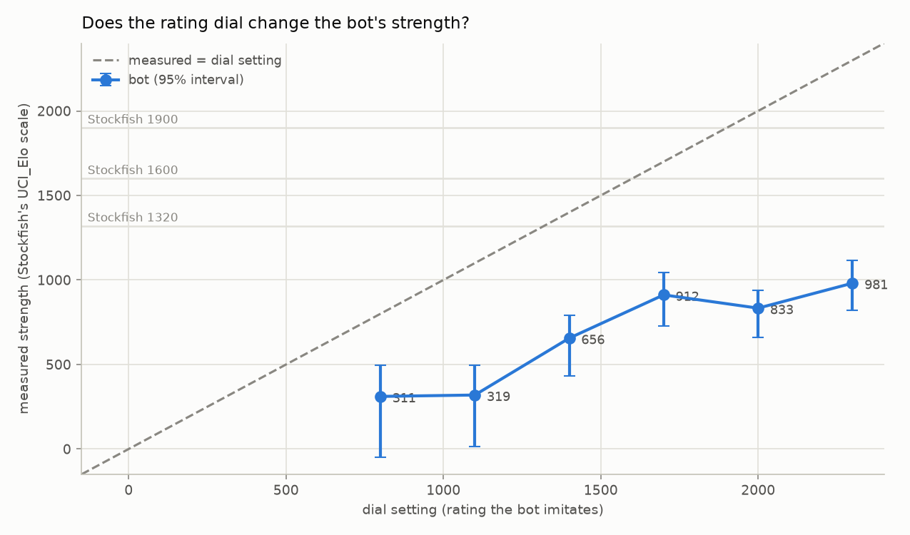
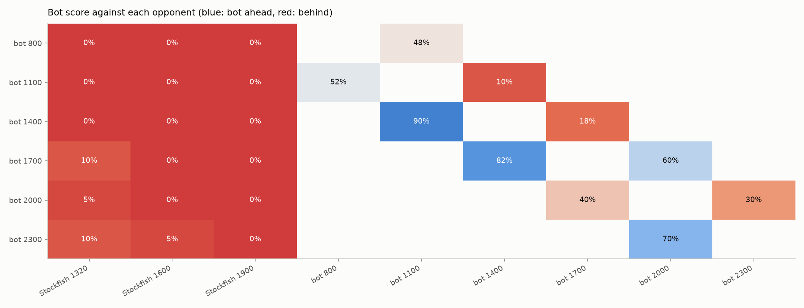

# Elo-dial validation: laptop_64x6_best_model

## Summary

- 460 games: every bot setting against Stockfish 1320, Stockfish 1600, Stockfish 1900, and bot against bot (adjacent).
- Rank correlation between the dial and measured strength: **0.94** (1 = strength always rises with the dial). A linear fit gives **49 Elo of measured strength per 100 points on the dial**.
- From 800 to 2300 on the dial, measured strength goes from 311 to 981 (+670 Elo for +1500 on the dial).
- 85% of games were decided by the judge (the bots never resign).

## Measured strength per setting

| dial | measured Elo | 95% interval | vs Stockfish 1320 | vs Stockfish 1600 | vs Stockfish 1900 |
|---|---:|---:|---:|---:|---:|
| 800 | 311 | -49 to 496 | 0% | 0% | 0% |
| 1100 | 319 | 13 to 495 | 0% | 0% | 0% |
| 1400 | 656 | 431 to 793 | 0% | 0% | 0% |
| 1700 | 912 | 726 to 1043 | 10% | 0% | 0% |
| 2000 | 833 | 660 to 938 | 5% | 0% | 0% |
| 2300 | 981 | 821 to 1116 | 10% | 5% | 0% |

**Each step up the dial**

| step | measured gap | chance the higher setting is stronger |
|---|---:|---:|
| bot 800 -> bot 1100 | +8 | 58% |
| bot 1100 -> bot 1400 | +337 | 100% |
| bot 1400 -> bot 1700 | +256 | 100% |
| bot 1700 -> bot 2000 | -78 | 9% |
| bot 2000 -> bot 2300 | +148 | 99% |

## Every pairing

| pairing | games | +/=/- (first player) | score | judged | avg. plies |
|---|---:|---:|---:|---:|---:|
| bot 800 vs Stockfish 1320 | 20 | 0/0/20 | 0% | 17 | 47 |
| bot 800 vs Stockfish 1600 | 20 | 0/0/20 | 0% | 18 | 48 |
| bot 800 vs Stockfish 1900 | 20 | 0/0/20 | 0% | 16 | 35 |
| bot 1100 vs Stockfish 1320 | 20 | 0/0/20 | 0% | 13 | 57 |
| bot 1100 vs Stockfish 1600 | 20 | 0/0/20 | 0% | 18 | 48 |
| bot 1100 vs Stockfish 1900 | 20 | 0/0/20 | 0% | 18 | 35 |
| bot 1400 vs Stockfish 1320 | 20 | 0/0/20 | 0% | 16 | 62 |
| bot 1400 vs Stockfish 1600 | 20 | 0/0/20 | 0% | 15 | 52 |
| bot 1400 vs Stockfish 1900 | 20 | 0/0/20 | 0% | 15 | 47 |
| bot 1700 vs Stockfish 1320 | 20 | 2/0/18 | 10% | 18 | 54 |
| bot 1700 vs Stockfish 1600 | 20 | 0/0/20 | 0% | 17 | 49 |
| bot 1700 vs Stockfish 1900 | 20 | 0/0/20 | 0% | 18 | 48 |
| bot 2000 vs Stockfish 1320 | 20 | 1/0/19 | 5% | 14 | 69 |
| bot 2000 vs Stockfish 1600 | 20 | 0/0/20 | 0% | 15 | 45 |
| bot 2000 vs Stockfish 1900 | 20 | 0/0/20 | 0% | 17 | 48 |
| bot 2300 vs Stockfish 1320 | 20 | 2/0/18 | 10% | 17 | 53 |
| bot 2300 vs Stockfish 1600 | 20 | 1/0/19 | 5% | 18 | 49 |
| bot 2300 vs Stockfish 1900 | 20 | 0/0/20 | 0% | 18 | 48 |
| bot 800 vs bot 1100 | 20 | 9/1/10 | 48% | 17 | 48 |
| bot 1100 vs bot 1400 | 20 | 2/0/18 | 10% | 19 | 56 |
| bot 1400 vs bot 1700 | 20 | 3/1/16 | 18% | 18 | 57 |
| bot 1700 vs bot 2000 | 20 | 12/0/8 | 60% | 20 | 62 |
| bot 2000 vs bot 2300 | 20 | 5/2/13 | 30% | 18 | 65 |

**How games ended:** adjudicated (decisive advantage) 390, checkmate 66, insufficient material 4

## Setup and caveats

- Model `checkpoints/laptop_64x6/best_model.pt`; bots sample with temperature 1.
- Stockfish 19 limited with `UCI_LimitStrength` / `UCI_Elo`, 50 ms per move. Its Elo scale was calibrated by the Stockfish team at longer time controls against engines; it is **not** the Lichess blitz scale the bot was trained on, so measured numbers are comparable with each other, not with Lichess ratings.
- A judge (full Stockfish, 20,000 nodes) ends a game when one side has been ahead by 800 centipawns for 8 plies in a row; after 300 plies its last evaluation decides.
- Intervals: 200 bootstrap resamples of the games within each pairing.
