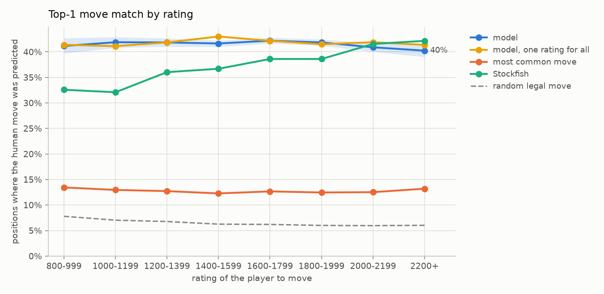
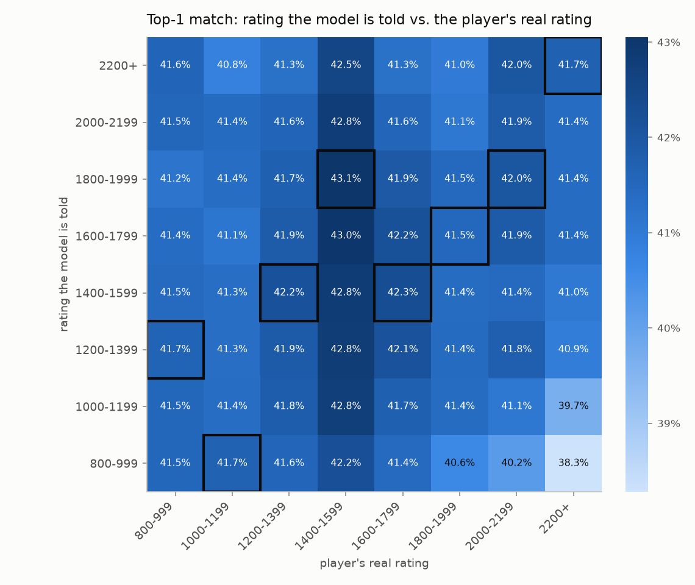
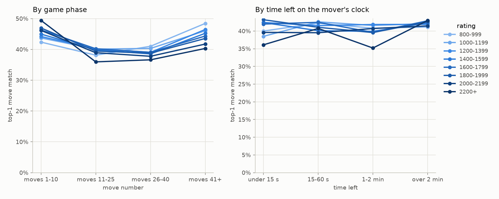
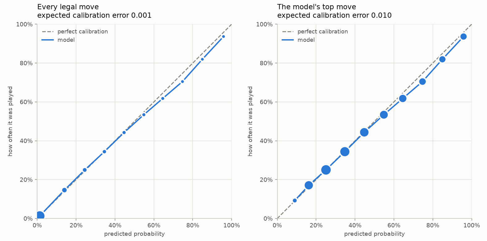

# Evaluation: laptop_64x6_best_model

## Summary

- **Top-1 move match: 41.7%** (41.4-42.0) of 172,086 held-out positions (test split, 2,444 games); top-3 68.6%, top-5 79.6%.
- Mean log-likelihood of the human move -1.922 (perplexity 6.83, out of 29.7 legal moves on average).
- most common move: 12.6% (it knows 14.4% of the positions; on those it scores 47.6% vs. the model's 47.9%).
- most common move (same rating): 12.5% (it knows 14.4% of the positions; on those it scores 46.5% vs. the model's 47.9%).
- Stockfish depth 10: 37.6% on 10,000 sampled positions (the model scores 42.3% on the same ones).
- random legal move: 6.3%.
- Model minus most-common-move baseline: +29.1 points (28.8-29.3).
- Telling the model each player's real rating scores 42.0%; the best single rating for everyone (1600-1799) scores 42.0% on the same 40,000 positions.

## Accuracy by rating

| rating | positions | model top-1 | top-3 | top-5 | log-lik | most common | same-rating common | Stockfish | random |
|---|---:|---:|---:|---:|---:|---:|---:|---:|---:|
| 800-999 | 6,366 | 41.2% (39.7-42.7) | 67.7% | 78.5% | -1.958 | 13.4% | 13.3% | 32.6% | 7.8% |
| 1000-1199 | 14,750 | 41.9% (40.8-42.9) | 68.6% | 79.3% | -1.932 | 13.0% | 12.8% | 32.1% | 7.0% |
| 1200-1399 | 21,817 | 41.9% (41.1-42.7) | 69.0% | 79.8% | -1.908 | 12.7% | 12.5% | 36.0% | 6.8% |
| 1400-1599 | 31,273 | 41.6% (41.0-42.2) | 68.0% | 79.5% | -1.929 | 12.3% | 12.1% | 36.7% | 6.3% |
| 1600-1799 | 36,848 | 42.2% (41.7-42.8) | 69.2% | 80.1% | -1.898 | 12.7% | 12.4% | 38.6% | 6.2% |
| 1800-1999 | 33,309 | 41.9% (41.2-42.5) | 68.9% | 80.0% | -1.908 | 12.5% | 12.3% | 38.6% | 6.0% |
| 2000-2199 | 19,083 | 40.9% (40.1-41.7) | 68.3% | 79.1% | -1.945 | 12.5% | 12.4% | 41.6% | 6.0% |
| 2200+ | 8,640 | 40.2% (39.0-41.5) | 66.6% | 78.2% | -1.982 | 13.2% | 13.5% | 42.2% | 6.0% |
| **all** | 172,086 | **41.7%** | 68.6% | 79.6% | -1.922 | 12.6% | 12.5% | 37.6% | 6.3% |

Brackets: 95% confidence intervals from 1,000 bootstrap resamples of whole games. Stockfish is scored on a random sample of positions; every other column on all of them.

## Does the model play like each rating?

Each column is one group of players; each row tells the model a different rating. Outlined: the rating that predicts that group best.

| players rated | model told their rating | best rating to tell the model |
|---|---:|---:|
| 800-999 | 41.5% | 1200-1399 |
| 1000-1199 | 41.4% | 800-999 |
| 1200-1399 | 41.9% | 1400-1599 |
| 1400-1599 | 42.8% | 1800-1999 |
| 1600-1799 | 42.2% | 1400-1599 |
| 1800-1999 | 41.5% | 1600-1799 |
| 2000-2199 | 41.9% | 1800-1999 |
| 2200+ | 41.7% | 2200+ |

## When is the model right?

**Game phase**

| game phase | positions | top-1 | top-5 | random |
|---|---:|---:|---:|---:|
| moves 1-10 | 48,880 | 45.6% | 85.8% | 3.8% |
| moves 11-25 | 65,245 | 39.6% | 76.7% | 4.9% |
| moves 26-40 | 37,431 | 38.8% | 75.4% | 8.4% |
| moves 41+ | 20,530 | 44.3% | 81.7% | 13.3% |

**Mover's clock**

| mover's clock | positions | top-1 | top-5 | random |
|---|---:|---:|---:|---:|
| under 15 s | 7,880 | 41.0% | 78.2% | 12.5% |
| 15-60 s | 20,692 | 41.2% | 78.0% | 10.4% |
| 1-2 min | 32,277 | 40.0% | 76.6% | 7.9% |
| over 2 min | 111,237 | 42.3% | 80.9% | 4.7% |

**Legal moves**

| legal moves | positions | top-1 | top-5 | random |
|---|---:|---:|---:|---:|
| 1-10 moves | 16,761 | 63.0% | 98.6% | 33.8% |
| 11-25 moves | 32,305 | 42.3% | 80.7% | 5.2% |
| 26-40 moves | 95,995 | 39.6% | 77.9% | 3.1% |
| 41+ moves | 27,025 | 35.1% | 72.6% | 2.2% |

## Calibration

- Every legal move: expected calibration error 0.0007 over 5,107,111 predictions.
- The model's top move: expected calibration error 0.0104.
- Value head (game result from this position): 61.3% of results guessed right (wins 48%, draws 5%, losses 47%), log loss 0.767, Brier 0.474, score calibration error 0.0083.

## Setup

|  |  |
|---|---:|
| model file | `checkpoints/laptop_64x6/best_model.pt` |
| trained steps | 10000 |
| dataset | `data/processed/datasets/lichess_2026-10_sample` |
| split | test (172,086 positions, 2,444 games) |
| Stockfish | depth 10, 10,000 sampled positions |
| evaluation time | 521 s |
