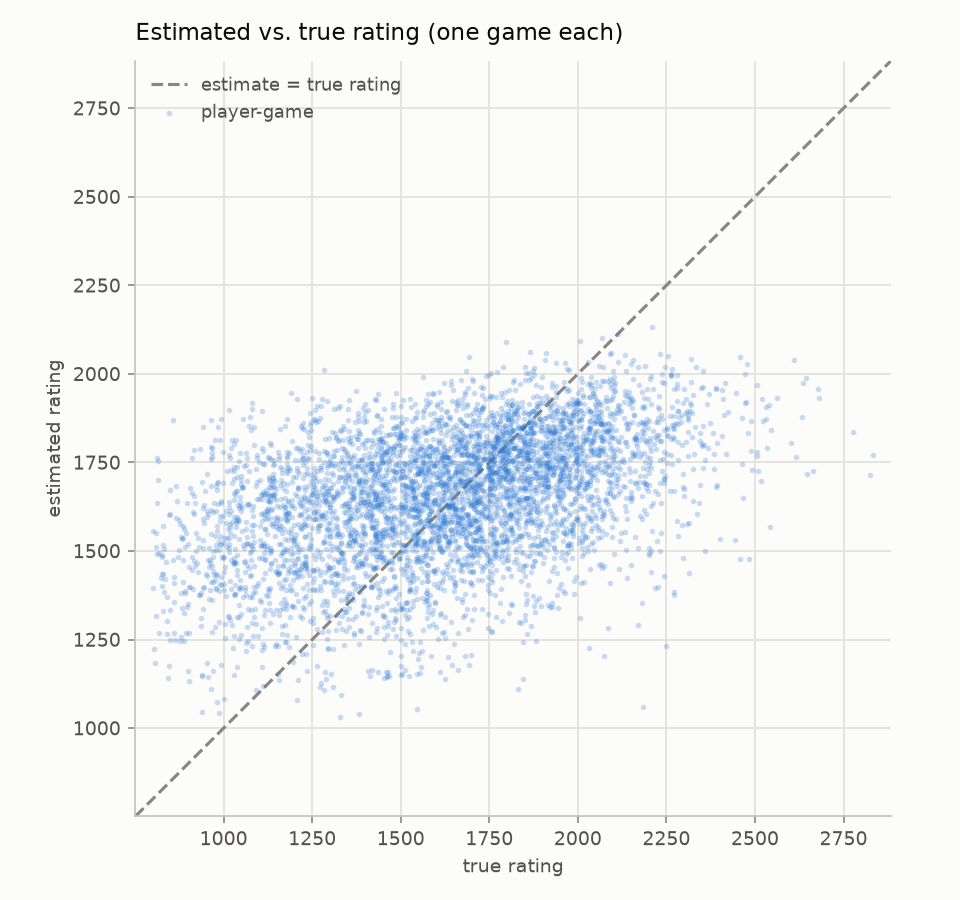
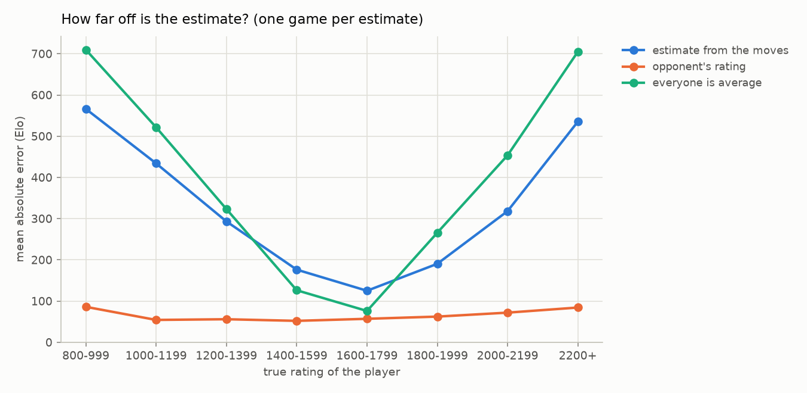
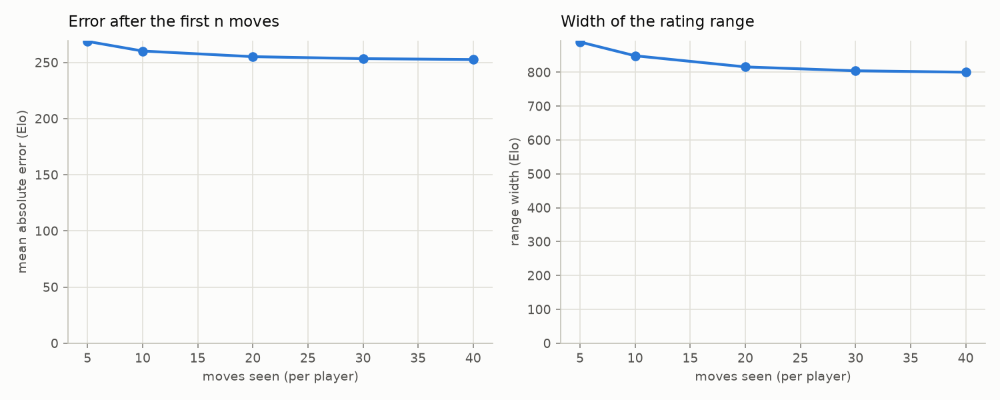

# Rating estimation: laptop_64x6_best_model

## Summary

- From **one game** (35 moves on average), the estimate is off by **253 Elo** on average (median 213, bias +23), over 4,888 held-out player-games.
- Baselines: guessing the opponent's rating is off by 61, guessing the average rating (1629) by 286. The estimate beats the average but **not** the opponent's rating: when the opponent's rating is known, it is the better single guess.
- The 80% ranges contain the true rating 79% of the time (average width 797 Elo), after tempering the evidence by 1.2 (fitted on val games).
- More moves help: after 5 moves the error is 269 and the range 889 wide; with every move of the game, 253 and 797.

## By true rating

| true rating | player-games | error | bias | in 80% range | range width | opponent's rating | average |
|---|---:|---:|---:|---:|---:|---:|---:|
| 800-999 | 199 | 566 | +566 | 18% | 873 | 86 | 710 |
| 1000-1199 | 440 | 434 | +434 | 50% | 848 | 54 | 522 |
| 1200-1399 | 638 | 293 | +280 | 79% | 826 | 56 | 323 |
| 1400-1599 | 910 | 176 | +109 | 95% | 805 | 52 | 126 |
| 1600-1799 | 1,065 | 125 | -32 | 98% | 799 | 57 | 76 |
| 1800-1999 | 923 | 190 | -176 | 90% | 766 | 62 | 266 |
| 2000-2199 | 492 | 318 | -318 | 66% | 751 | 72 | 454 |
| 2200+ | 221 | 535 | -535 | 12% | 734 | 84 | 705 |
| **all** | 4,888 | 253 | +23 | 79% | 797 | 61 | 286 |

Errors are mean absolute errors in Elo; bias is estimate minus truth (negative = estimates too low).

## More moves, better estimates

| moves seen | error | in range | range width |
|---|---:|---:|---:|
| first 5 (avg. 5) | 269 | 82% | 889 |
| first 10 (avg. 10) | 260 | 81% | 849 |
| first 20 (avg. 19) | 255 | 80% | 816 |
| first 30 (avg. 27) | 253 | 79% | 804 |
| first 40 (avg. 31) | 253 | 79% | 800 |
| all (avg. 35) | 253 | 79% | 797 |

## Setup

- Model `checkpoints/laptop_64x6/best_model.pt`, scored on the test split; each estimate uses one side of one game, with the opponent's real rating and both clocks given to the model.
- Prior: data; rating grid 600-2800; temper 1.19 (moves within a game are correlated evidence, so their summed log-likelihood is divided by it to keep the ranges honest).
